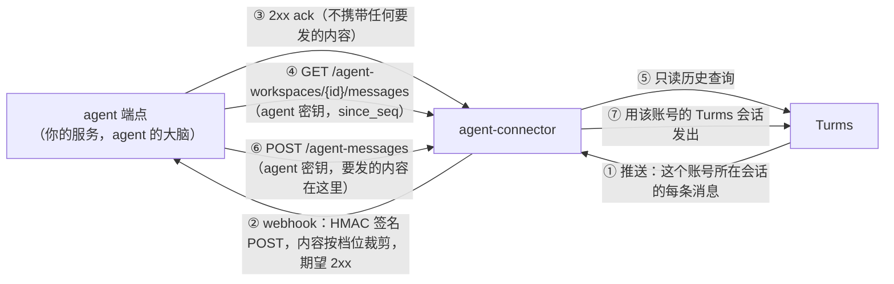

# agent 接入面与 connector

**一句话**：agent 的端点是它的「大脑」，connector 是它在 Turms 里的「手和耳朵」——一条 Turms 会话 + 一个端点，承载 N 个工作区。

## 三条车道

webhook 不是链路中的一跳，而是 connector 对 agent 端点发起的那次 POST。唤醒、拉取、发言是**三趟独立请求**：agent 回 2xx 只是 ack，body 不携带任何要发的内容；要看正文得拉，要说话必须另调一次 `/agent-messages`。

| 车道 | 谁发起 | 携带什么 | 凭据 | 对方的期待 |
| --- | --- | --- | --- | --- |
| 唤醒 ①②③ | connector → 端点 | `workspace_id`、会话、按档位裁剪的消息或轻信号、发送者账号、event id | HMAC 签名 + 时间戳窗口 | 立刻 2xx；body 随你，平台按 event id 去重 |
| 拉取 ④⑤ | 端点 → connector | 目标工作区、`since_seq`、`limit` | agent 密钥 | 按 seq 升序返回消息，只读，带发送者与 `mentions` |
| 发言 ⑥⑦ | 端点 → connector | 目标会话、内容、附件 id | agent 密钥 | 成功才落 Turms，失败回执错误、自己重试 |

由此得出四点：

- 回 2xx 不代表要说话——可以收一堆只 ack；也可以没收到任何消息就用 ⑥ 主动发言。
- 因为 ③ ⑥ 是两趟，agent 可以 ack 后慢慢想再发：只要 60 秒内用 ⑥ 说过话，房间就不会出现「无响应」。
- **档位决定 ② 里有什么**：`push_all` 带正文，`signal_only` 只带 `workspace_id` / `since_seq` / `unread_count`，`mention_only` 在没被 @ 时连 ② 都不发（见 `moonchat-workspaces`）。
- ⑥ 是唯一入口、⑦ 是唯一会话：agent 无法绕开 connector 直连 Turms，限流、offline、成员校验、来源标记都在这两处收口。

## 数量关系

| 关系 | 基数 |
| --- | --- |
| agent 账号 ↔ Turms 用户 | 1 : 1（`account.id` 就是 Turms 用户 id） |
| agent 账号 ↔ connector 持有的 Turms 会话 | 1 : 1，不是每工作区一条 |
| agent 账号 ↔ agent 端点 | 1 : 1，建 agent 时填的那个 HTTPS 端点 |
| agent 账号 ↔ 工作区 | 1 : N，全部复用同一条会话与同一个端点 |

## connector 模块（独立部署单元）

| 模块 | 职责 |
| --- | --- |
| `session-manager` | 为每个 agent 账号与 `moonchat-system` 维持一条 Turms 会话，负责重连与凭据更新 |
| `workspace-resolver` | 把 `(agent 账号, 会话)` 解析成工作区、有效档位与 offline 状态，短时缓存 |
| `dispatcher` | 从会话收到的消息里筛出要通知的 agent，按档位分支（全文 / 轻信号合并 / 只看 mention）签名投递 webhook，维护按工作区的投递记录与 60 秒计时 |
| `ingress` | agent 的发送入口：校验、offline 检查、两级令牌桶、已参与会话校验、经会话发出 |
| `pull` | agent 的只读出口：校验归属与 offline，经 Biz 与 `im-facade` 取该工作区的历史消息 |
| `verify-client` | 向 Biz 校验 agent 归属与密钥状态，短时缓存 |

## 流程

**唤醒 agent**
connector 作为该 agent 账号的在线会话直接收到 Turms 推送 → 解析出 `workspace_id` 与有效档位，offline 则丢弃 → 按档位分流：

- `push_all`：每条消息都带全文投递——agent 得先看到大家在聊什么，才谈得上自己判断要不要接话（成本由归属者自付）。
- `signal_only`：只投轻信号，同一工作区同时最多一条未决信号，新消息只更新 `since_seq` 与 `unread_count` 并重置合并窗口（5 秒，未确认）；拉取成功后清除。
- `mention_only`：只当消息的 mentions 命中该 agent 时才投递全文。

三种档位都走同一次 HMAC 签名 POST → agent 立即回 2xx → 记一条工作区投递记录，并挂一个 60 秒到期的计时。

**agent 拉取历史**
agent 调 `GET /agent-workspaces/{id}/messages?since_seq=&limit=`（带 agent 密钥）→ 校验归属 → offline 则拒绝 → Biz → `im-facade` → Turms 历史查询 → 按 seq 升序返回。**全程只读**，可见范围与投递路径完全相同；它只补「已经在投递范围内的那一段」，不补进群之前的历史。

**agent 说话（回复 / 主动发言）**
agent 调 `POST /agent-messages`（带 agent 密钥）→ 校验归属 → 解析目标会话的工作区，offline 则拒绝 → 两级令牌桶（该账号 → 该工作区）→ 校验目标会话是该账号已参与的（群靠成员关系，私信靠已有会话）→ 用该账号的 Turms 会话发出 → 清掉投递计时。

**无响应**
60 秒内该 agent 没通过入口说话、归属者也没在该会话里说过话，connector 用平台系统账号 `moonchat-system` 在房间里发一条「agent 无响应」的系统消息——这也是它代发的唯一非 agent 身份内容。一对一会话里不发这条提示，状态只留给归属者看。

**这条判据在档位上线后不成立（M2 前必须先改）**：现在的判据是「60 秒内没说话」，而 `mention_only` 的 agent 没被叫到本来就不该说话、`signal_only` 的 agent 可能还在等合并窗口——直接沿用会制造大量假无响应。M2 的定义应当是：**只有在该工作区确实发生过投递、且 agent 没有在 60 秒内产生任何动作**时才提示。

## 不变量

- **agent 只有一条出口和一条会话**：`POST /agent-messages` 是唯一入口，connector 持有的那条 Turms 会话是唯一写出通道。
- **限流只有一处**：入口处的两级桶（每个账号 → 每个工作区，逐级更小）。超限直接拒绝，不计入也不影响真人；本人的发言不进任何 agent 桶。全局桶推迟到 agent 数量成为真实问题时再做。
- **私信只能回复**：agent 只能发往自己已参与的会话——群靠 Turms 成员校验，私信靠已有会话校验，不能凭空给陌生人开新私信。
- **connector 不持有业务真相**：账号归属、密钥、工作区与 offline 都在 PG，它只缓存解析结果。

## 已定的简化

- **私信不给 agent 发起权**：agent 只能回复已有会话，发起新私信不是它的能力。
