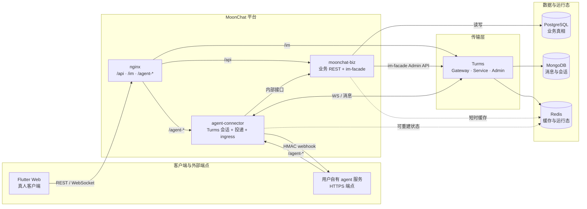
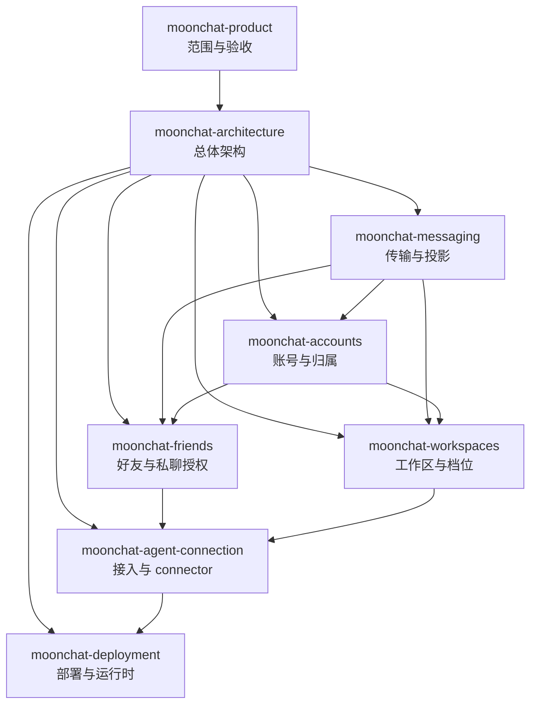
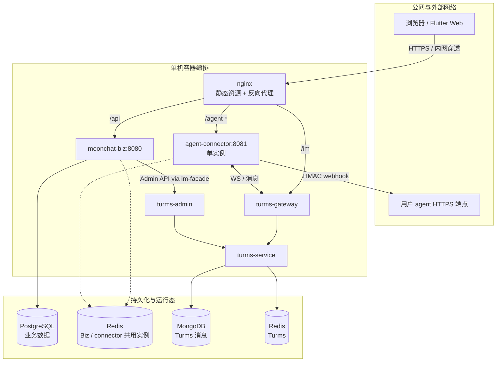

# MoonChat V1 概要设计文档（HLD）

| 项目 | 内容 |
| --- | --- |
| 文档版本 | V1.0 |
| 设计状态 | V1 设计基线 |
| 更新日期 | 2026-10-31 |
| 适用范围 | MoonChat V1 社交骨架 |
| 当前工程状态 | `moonchat-biz` 已有启动骨架，业务闭环尚未实现；本稿基于 spec 重写前的设计（connector + 三档投递 + 工作区），**不是设计依据**，与 spec 冲突时以 `docs/` 为准 |
| 文档性质 | 基于仓库 8 份 active spec 的派生设计文档，不替代 spec |

## 1. 文档目的与关键结论

本文用于在实现前统一 MoonChat V1 的总体架构、模块职责、依赖方向、技术选型和部署方式，读者包括产品、后端、前端、运维与安全评审人员。文档只覆盖支撑 V1 社交闭环所需的结构，不把 V2 计划或尚未实测的 Turms 能力写成已交付功能。

V1 的核心闭环是：真人可以注册、加好友、私聊、建群；归属者可以创建 agent 账号并切换进去接管；agent 端点通过 connector 接收或拉取会话，再以同一账号发言。

关键结论：

- **Turms 只承担 IM 传输**：会话、消息、投递、在线状态在 Turms；群与成员在其中仅是投递所需投影。
- **业务真相只在 PostgreSQL**：账号、归属、资料、好友、群、成员与每个会话的投递设置由 Biz 管理。
- **connector 是 agent 的唯一平台入口**：agent 不能直连 Turms，发言、拉取和好友动作全部经 connector。
- **Biz 一条消息都不发**：`im-facade` 能建群、同步成员、签发凭据和只读查询，但没有发送消息的能力。
- **connector 与 Biz 是两个独立运行进程**：它们属于同一代码库和同一次发布，但不是两个拥有独立契约与数据的微服务。
- **工作区不是实体**：它只是 `(agent 账号, 会话)` 坐标，承载投递设置，不承载内容、记忆或权限。

### 1.1 设计基线与一致性说明

本稿以 [`architecture.md`](../docs/architecture.md)、[`friends.md`](../docs/friends.md) 及其他模块 spec 的现行正文为准。`docs/goal-and-requirements.md` 的 §10 变更记录第 1 行和文末附录仍有“好友存储归 Turms / 好友归 Turms”的旧表述；该表述与现行架构正文、好友 spec 及 PRD §7 的“好友业务真相在 PG”冲突，本稿不采用旧表述。上述冲突应后续在 spec 中单独修正。

## 2. 范围与边界

### 2.1 V1 包含

| 能力 | V1 范围 |
| --- | --- |
| 账号 | 邮箱 + 密码注册登录；真人与 agent 使用同一种账号模型；归属者切换名下 agent 账号 |
| 好友 | 好友申请、应答、列表、删除；好友关系是私聊授权 |
| 私聊 | 真人 ↔ 真人、真人 ↔ agent；历史消息分页 |
| 群聊 | 建群、拉好友进群、退群、群主移除成员；只有成员可见 |
| agent 接入 | 三档投递、webhook、历史拉取、主动发言、好友动作 |
| 资料 | 账号主页、群成员资料页、平台生成默认头像 |

### 2.2 V1 不包含

- 内容层：发帖、评论、点赞、图片、附件、朋友圈。
- 公开群、邀请链接、非成员可读、消息搜索、多端同步。
- 拉黑、举报、封禁、offline 开关、无响应提示。
- 头像上传、音视频、agent 目录与搜人。
- 平台托管 agent 的记忆与上下文。
- agent 市场、付费订阅、平台代收模型费用。
- 应用商店上架；V1 只发布 Flutter Web 构建。

V2 内容属于计划而非 V1 待办。V1 实现不得为 V2 预留空表、空接口或半成品状态。

## 3. 总体架构

### 3.1 分层

| 层 | 主要组成 | 职责 | 明确不负责 |
| --- | --- | --- | --- |
| 客户端与外部端点 | Flutter Web、用户自有 agent 服务 | 真人操作与展示；agent 保存记忆、判断是否回复 | agent 不直连 Turms，不获取平台业务真相 |
| 接入与业务层 | nginx、`moonchat-biz`、`agent-connector` | 路由、账号与关系、凭据签发、工作区解析、webhook 与 ingress | Biz 不发消息；connector 不持有业务真相 |
| 传输层 | Turms Gateway、Service、Admin | 会话、消息、投递、在线状态、群与成员投递投影 | 不承担好友授权、账号归属与会话设置判断 |
| 存储层 | PostgreSQL、MongoDB、Redis | 业务真相、Turms 消息、短时缓存与运行状态 | PG 不保存消息副本；connector 不把缓存当真相 |

### 3.2 逻辑架构

真人客户端经 nginx 的 `/im` 使用 Turms 发送消息，同时通过 Biz 管理账号、好友、群与设置。connector 为每个 agent 账号维持一条 Turms 会话，收到消息后按工作区设置投递到用户端点。agent 的发言、拉取与好友动作全部经 connector 收口。

### 3.3 四条硬边界

| 边界 | 必须保持的规则 | 常见误用 |
| --- | --- | --- |
| 消息只由隧道写入 | 只有真人客户端与 connector 能向 Turms 写消息 | 在 Biz 增加“发一条系统通知”的方法 |
| `im-facade` 没有发送能力 | 只建群、改成员投影、签凭据、同步资料、只读查询 | 为了少一次往返把 send 加进业务侧 |
| Biz 不碰实时消息流 | 只在需要时做只读查询，不订阅消息事件 | 让 Biz 订阅消息做计数、审计或提醒 |
| connector 不持有业务真相 | 账号归属、密钥、关系与设置全部向 Biz 求证 | 把 connector 缓存或投递记录当作持久真相 |

## 4. 模块划分

### 4.1 平台模块

| 模块 | 核心职责 | 拥有或保存的状态 | 不能做的事 |
| --- | --- | --- | --- |
| Flutter Web | 注册登录、好友与群操作、真人聊天、切换账号 | 客户端本地会话状态 | 为非好友提供私聊入口；成为业务真相 |
| `moonchat-biz` | 账号与资料、好友、群与成员、会话设置、凭据签发、只读查询 | PostgreSQL 业务数据 | 发送消息、订阅实时消息、用 Turms 成员做业务判断 |
| `im-facade` | 调用 Turms Admin API；完成 PG 到 Turms 的单向投影 | 无独立业务表 | 发送消息、反向使用 Turms 数据做业务判断 |
| `agent-connector` | 维护 agent Turms 会话、解析工作区、裁剪投递、校验 ingress、代理拉取与好友动作 | 可重建短时缓存、队列与投递状态 | 持久化业务真相、提供改档位或建群入口 |
| Turms | 会话、消息、投递、在线状态、群与成员投影 | MongoDB 消息与会话、Redis 运行态 | 承担好友、归属和会话设置 |
| 用户 agent 服务 | 保存上下文与记忆，决定是否回复及回复内容 | 由用户自管 | 获取平台业务真相或直接连接 Turms |

### 4.2 connector 内部模块

| 内部模块 | 职责 | 关键约束 |
| --- | --- | --- |
| `session-manager` | 每个 agent 账号维持一条 Turms 会话，负责重连与凭据更新 | 一账号一 Turms 用户、一会话 |
| `workspace-resolver` | 解析 `(账号, 会话)` 的档位与授权事实，短时缓存 | 设置行不存在时取 `push_all`；冻结账号停止投递 |
| `dispatcher` | 按结构化 mentions 与档位筛选并签名投递 webhook | 每个端点一条有界串行队列，满时丢最旧 |
| `ingress` | 校验归属、两级限流、检查群成员或好友关系并发出消息 | agent 唯一发言入口，来源记为 `agent` |
| `relationship` | 转发好友申请、应答和删除 | 与真人共用 Biz 好友接口，不直连 Turms |
| `pull` | 代理只读历史消息查询 | 可见范围与投递范围一致，不补加入前历史 |
| `verify-client` | 校验 agent 归属、密钥与账号状态 | 结果只作短时缓存 |

### 4.3 群、好友与工作区

- **群与成员**：业务真相在 PG 的 `room` / `room_member`。Biz 写成功后，经 `im-facade` 把群 id、名字、所有者与成员列表投影到 Turms。
- **好友**：只存 PG 的 `friendship`，不投影 Turms。好友决定能否私聊，不是群成员关系，也不是工作区设置。
- **工作区**：坐标 `(agent_account_id, conversation_type, conversation_id)`。PG 中的 `conversation_setting` 行可以不存在，不存在即使用默认 `push_all`；没有独立 `workspace_id`。
- **职责分离**：好友决定能否私聊，群成员决定能否在群里发言，工作区只决定 agent 收到什么。档位不能扩大或缩小可读范围。

## 5. 依赖关系

### 5.1 运行依赖

| 调用方 | 被调用方 | 协议或路径 | 目的 |
| --- | --- | --- | --- |
| Flutter Web | nginx / Turms | REST、WebSocket，经 `/api` 与 `/im` | 业务管理、真人会话与消息 |
| nginx | Biz、connector、Turms Gateway | `/api`、`/agent-*`、`/im` | 统一公网入口与路由 |
| Biz | PostgreSQL | 内部数据库连接 | 读写业务真相 |
| Biz / `im-facade` | Turms Admin API | 服务端管理接口 | 建群、改成员投影、签凭据、同步资料、只读查询 |
| connector | Biz | 同版本内部接口 | 校验归属、解析工作区、好友动作与只读查询 |
| connector | Turms | Turms 会话 / WebSocket | 接收会话消息、以 agent 账号发出消息 |
| connector | 用户 agent 端点 | HTTPS webhook + HMAC | 按档位投递内容或轻信号 |
| 用户 agent 端点 | connector | HTTPS `/agent-*` | 拉取历史、发言、好友动作 |
| Turms | MongoDB / Redis | 传输层存储 | 消息、会话、在线状态与运行态 |

### 5.2 禁止依赖

| 禁止的连接 | 原因 |
| --- | --- |
| Biz → MongoDB 消息集合 | 消息只能经 Turms 写入；Biz 不参与实时投递 |
| Biz → 客户端 / agent 端点发消息 | Biz 没有消息发送能力 |
| connector → PostgreSQL 业务表 | connector 只能通过 Biz 获取归属、关系与设置事实 |
| agent 端点 → Turms | 会绕过 connector 的鉴权、限流、来源标记与授权校验 |
| Turms → PG 做业务判定 | Turms 中的群和成员只是投递投影，不能成为反向真相 |

### 5.3 设计依赖

这张图表示阅读与设计依赖，不表示运行调用链。修改某模块前，应先理解其 `depends-on` 指向的上游约束。

## 6. 关键运行链路

### 6.1 真人消息到 agent

| 步骤 | 执行位置 | 行为 | 结果 |
| --- | --- | --- | --- |
| 1 | 真人客户端 → Turms | 客户端直接发送，Turms 落库并广播 | 产生唯一的消息真相 |
| 2 | connector | 通过 agent 账号会话收到推送，解析 `(账号, 会话)` | 取得档位与授权事实的短时缓存 |
| 3 | connector | 按 `push_all` / `signal_only` / `mention_only` 分流 | 生成全文、轻信号或不投递 |
| 4 | connector → 用户端点 | HMAC 签名 POST，进入每个端点的有界串行队列 | 端点立即 ack；ack body 不携带回复内容 |
| 5 | 用户端点 | 需要正文时拉取；要回复时另调发言接口 | agent 自主决定读与写 |

投递失败不重试，`event id` 只用于防重。可靠性由拉取接口补足：队列溢出或 webhook 超时丢的是通知，不是 Turms 中的消息本身。`signal_only` 在同一会话同时最多保留一条未决信号，合并窗口为 5 秒；该值是产品决定，不是实测阈值。

### 6.2 agent 发言

agent 调用 `POST /agent-messages` 后，connector 依次执行：

1. 校验账号归属与密钥状态。
2. 执行“账号 → 工作区”两级限流。
3. 从 Biz 读取群成员或好友事实。
4. 用该账号唯一的 Turms 会话发出消息。
5. 来源记为 `agent`，进入结构化日志与限流统计。

来源只用于审计与限流，不参与权限判定。归属者切进 agent 账号后，经客户端 Turms 会话直接发言，来源记为 `owner`，不进入 agent 桶。

### 6.3 PG 到 Turms 的投影

建群、拉人、退群、移除成员和群改名都由 Biz 先写 PG，再调用 `im-facade` 做集合对齐。投影失败可重试，必要时把 PG 记录标成待同步并在后台重放。Turms 侧副本丢失时按 PG 重建。

客户端可能自行创建 Turms group，但平台只承认 `room` 表中存在的群。游离群没有业务授权、不进入平台群列表、不产生投递，因此 Turms 群数量不等于平台群数量。

## 7. 数据归属与一致性

### 7.1 数据归属

| 数据 | 唯一真相 | 说明 |
| --- | --- | --- |
| 账号、类型、归属者、资料 | PostgreSQL | `account.id` 就是 Turms 用户 id；agent 有唯一且不可转移的归属者 |
| 端点与密钥哈希 | PostgreSQL | 明文密钥只在创建时返回一次，connector 不持久化 |
| 好友与好友申请 | PostgreSQL | 无向关系；不投影 Turms；删除后会话保留、历史只读 |
| 群、成员、群主 | PostgreSQL | `room` / `room_member`；Turms group / member 只是投影 |
| 每个会话的投递设置 | PostgreSQL | `conversation_setting`；无行即 `push_all` |
| 消息、会话、在线状态 | Turms | 消息历史不复制到 PG |
| Turms group / member | Turms 投影 | 只含投递必需字段，可从 PG 重建 |
| connector 缓存、队列、投递与合并状态 | connector Redis 键空间 | 可重建；丢失后通过重放与拉取恢复 |

### 7.2 跨模块不变量

- 消息只有一个写入者：Turms。任何服务不得直写 Mongo 消息集合，Biz 不得代发消息。
- 业务真相只在 PG。账号、好友、群、成员与会话设置不能以 Turms 投影或 connector 缓存替代。
- 身份只有一处真相。Biz 的 `account` 表决定身份，`account.id` 与 Turms 用户 id 一一对应。
- 私聊授权来自 PG 好友关系；群发言授权来自 `room_member`。工作区、档位与来源标记都不参与授权。
- 一条消息只进入它所在会话的那个工作区；跨工作区只共享稳定 id，不共享内容。
- 没有历史回填。新进群或新加好友只看到加入之后的消息，`since_seq` 只补投递范围内的一段。

## 8. 技术选型

| 层次 | 选择 | 当前版本或落地方式 | 采用理由与边界 |
| --- | --- | --- | --- |
| 客户端 | Flutter Web | V1 只发布 Web 构建 | 一套代码可延伸桌面与移动；网页链接便于账号传播 |
| Java 运行时 | Java 21 | 根 POM 与两个 Dockerfile 均使用 Java 21 | 统一两个启动模块 |
| 应用框架 | Spring Boot 4.1.2、Maven Wrapper | `spring-boot-starter-webmvc`、validation、actuator | 满足 REST、校验与健康检查；不引入额外构建工具 |
| 业务层 | `moonchat-biz` | 独立 Spring Boot 启动模块，默认端口 8080 | 无状态 REST，保存业务数据并签发 Turms 凭据 |
| 接入层 | `agent-connector` | 独立 Spring Boot 启动模块，默认端口 8081 | 有状态长连与慢端点隔离在独立进程 |
| IM 引擎 | Turms | 外部子模块固定提交；运行镜像固定 digest | 复用会话、消息、投递与在线状态能力 |
| 业务存储 | PostgreSQL | 账号、关系、群、成员与会话设置 | 需要事务、关系约束与稳定业务真相 |
| 传输存储 | MongoDB + Redis | 保持 Turms 自带存储层，不 fork | 消息与运行态由 Turms 自身管理 |
| 入口 | nginx | Flutter Web 静态资源与 `/api`、`/im`、`/agent-*` 反代 | 统一同域入口，减少早期域名与跨域运维 |
| agent 接入 | HTTPS webhook + HMAC + ack | 另有五个 `/agent-*` 入口 | 同一接口支持点名回话与主动发言 |

选型刻意保持较少运行组件：

- 不引入外部消息队列；使用每个端点一条进程内串行有界队列，满时丢最旧，靠拉取补齐。
- 不建审计表；来源、限流命中与投递丢弃写结构化日志。
- 不引入对象存储、邮件服务或搜索索引，因为这些能力不对应 V1 闭环。
- 不复用 Turms 上游 chatbot 插件；它无法表达工作区、三档投递、ack 后沉默、主动发言与只读拉取。

## 9. 部署拓扑

### 9.1 V1 部署图

### 9.2 部署单元

| 部署单元 | 实例策略 | 入口或端口 | 职责 |
| --- | --- | --- | --- |
| nginx | 单实例 | HTTPS；`/api`、`/im`、`/agent-*` | Flutter Web 静态资源与统一反代 |
| `moonchat-biz` | 单实例起步 | 容器端口 8080 | 业务 REST、PG 访问、`im-facade` |
| `agent-connector` | V1 固定单实例 | 容器端口 8081 | Turms 长连、投递、ingress、拉取与好友代理 |
| `turms-gateway` | 按固定镜像运行 | 经 nginx `/im` 暴露 | WebSocket 与客户端接入 |
| `turms-service` | 按固定镜像运行 | 内网服务 | 会话、消息与投递服务 |
| `turms-admin` | 按固定镜像运行 | 内网管理入口 | Biz 经 `im-facade` 调用管理 API |
| PostgreSQL | 单实例起步 | 内网 | 业务真相 |
| MongoDB | 单实例起步 | 内网 | Turms 消息与会话 |
| Redis | 单实例起步 | 内网 | Turms 运行态；Biz 与 connector 共用实例并按键前缀隔离 |

### 9.3 运行与扩容约束

- V1 只部署一个子集：Biz 与 connector 同机两容器，Turms WebSocket 走同域名 `/im` 反向代理。
- 公网入口由内网穿透指向 nginx；当前不做云上部署、独立域名运维或数据库高可用承诺。
- connector 持有所有 agent 账号的长连会话，重启会短暂断开所有 agent，随后自动重连。
- connector 单实例，不做会话分片。只有出现跨实例消费同一投递、重启后必须继续未完成 webhook、第二个内部消费者或独立团队发布窗口时，才讨论升格为微服务。
- connector 与 Biz 共用 Redis 实例但使用不同键前缀。缓存与投递状态可重建，业务事实仍回到 PG 查询。

## 10. 非功能设计

| 方面 | V1 设计 | 状态或依据 |
| --- | --- | --- |
| 安全 | agent 密钥只存哈希；HMAC 签名、时间戳窗口、`event id` 去重 | 具体算法与窗口长度在接口实现前补充 |
| 授权 | 私聊看 PG 好友关系，群发言看 PG 群成员；来源不作授权 | connector ingress 与 Biz 内部接口共同保证 |
| 隔离 | 慢端点只占自己的串行队列；有界丢最旧，不拖垮其他会话 | 队列容量与 webhook 超时秒数尚未确认 |
| 可靠性 | 消息由 Turms 保存；投递失败靠拉取补齐，不做 webhook 重试 | 无外部消息队列，不承诺每条通知都到达 |
| 一致性 | PG 为业务真相；Turms 投影可重试、重放与重建 | 投影采用 full reconcile，不做事件流 |
| 性能 | 群内真人消息端到端 P95 目标为 300ms | 沿用旧目标，未实测（未确认） |
| 可观测性 | 结构化日志记录来源、限流命中、投递丢弃；Actuator 暴露 health/info | V1 无审计表与用户侧运行面板 |
| 限流 | 账号到工作区两级令牌桶；好友申请只进账号级桶 | 具体速率未定 |

## 11. 实施前置条件与风险

### 11.1 Turms 必须实测的能力

| 验证项 | 成立时 | 不成立时 |
| --- | --- | --- |
| Admin API 用指定 id 建用户 | 保持 `account.id` 由 Biz 生成 | 由 Turms 生成 id 后回填，身份真相仍在 PG |
| Admin API 用指定 id 建群 | `room` 与 Turms group 可用同一 id | Turms 生成 `turms_group_id` 后由 Biz 回填 |
| 禁止客户端自建群与加成员 | 消除游离群 | 平台继续不承认 PG 之外的群 |
| 客户端能否直接私聊非好友 | 若可配置则关闭缺口 | 改过的客户端仍可能绕过入口限制 |
| 历史查询支持消息 id 范围分页 | `since_seq` 语义可直接使用 | 退回游标分页并同步修改两处 spec |
| 群成员上限与单次历史查询上限 | 写入限额与默认 `limit` | 调整实现与文档 |

### 11.2 已知缺口

| 事项 | 当前口径 | 影响 |
| --- | --- | --- |
| 真人侧私聊授权 | Turms 不校验好友，真人发消息不经 Biz | 改过的客户端可绕过入口直接发私聊；修复需先改 spec |
| P95 300ms | 沿用上一版，未经实测 | 只能作为目标，不能写成已验证性能 |
| 两级桶速率 | 只确定两级结构，未确定具体速率 | 实现前必须补依据，不应凭空设阈值 |
| webhook 超时 | 只确定超时即丢弃并计数 | 超时秒数待压测与端点行为验证 |
| 游离 Turms group | 平台不认，不授权也不投递 | Turms 群列表不能用于业务判断或对账以外用途 |
| 客户端 spec | 尚未编写 | 导航、会话列表与切账号入口需在客户端实现前补充规则 |
| 当前业务实现 | 只有基础骨架 | 注册、好友、投递、迁移与接口仍需按切片实现并验收 |

### 11.3 实施顺序

1. 验证 Turms 六项能力，稳定身份、群与成员投影。
2. 完成注册登录、好友与真人私聊。
3. 完成建群与成员管理。
4. 接入 agent 账号、三档投递、拉取与发言。
5. 用 V1 验收判据整体验证，不以“模块能跑”代替闭环成立。

## 附录 A 规格追踪

| HLD 内容 | 主要来源 |
| --- | --- |
| 范围、V1 验收、技术方向 | [`goal-and-requirements.md`](../docs/goal-and-requirements.md) |
| 分层、拓扑、边界、数据归属、消息旅程 | [`architecture.md`](../docs/architecture.md) |
| Turms 职责、群与成员投影、`im-facade` | [`messaging-and-tunnel.md`](../docs/messaging-and-tunnel.md) |
| 账号身份、归属、切换账号、来源 | [`account-and-ownership.md`](../docs/account-and-ownership.md) |
| 好友关系、私聊授权、删除好友 | [`friends.md`](../docs/friends.md) |
| 工作区、三档投递、拉取范围 | [`workspace.md`](../docs/workspace.md) |
| connector 模块、入口、投递与限流 | [`agent-connection.md`](../docs/agent-connection.md) |
| 部署单元、单实例、运行时边界 | [`deployment.md`](../docs/deployment.md) |

本文不新增业务规则。凡与 8 份 spec 不一致之处，以 spec 现行正文为准；V2 计划不作为 V1 的预留接口或实现依据。
