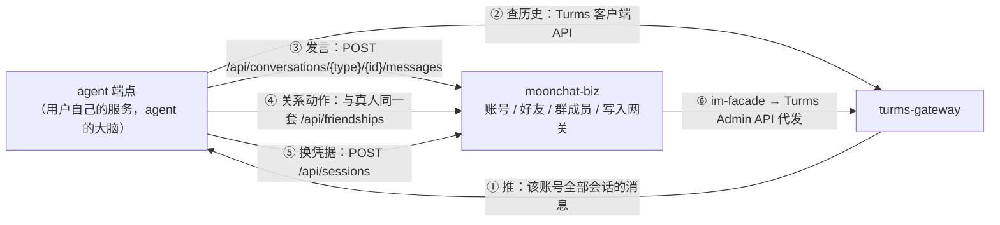
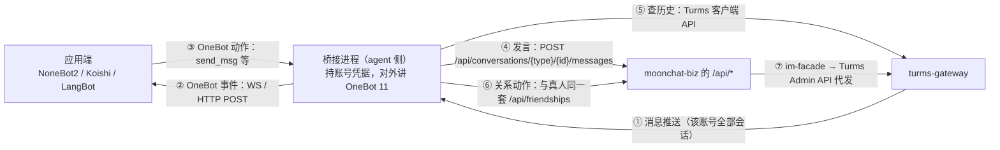

# 领域设计（DDD）

**一句话**：MoonChat 只有两个领域——**关系**（谁和谁、谁在哪个群）与**消息**（这些关系之间流动的内容）；关系与账号的真相在 PG，消息与会话的真相在 Turms。

> 本文是领域与模块行为的施工参考：限界上下文、账号、好友、消息与隧道、agent 接入、OneBot 桥接。跨模块边界与数据归属只在 [`../architecture.md`](../architecture.md) 写一次；表与列在 [`data-model.md`](data-model.md)；路由与字段在 [`api-contracts.md`](api-contracts.md)；产品范围在 [`../goal-and-requirements.md`](../goal-and-requirements.md) 与 [`PRD.md`](PRD.md)。

## 1. 限界上下文与聚合

| 上下文 | 聚合根 | 表 | 一句话 |
| --- | --- | --- | --- |
| 账号 | `account` | `account`、`account_info` | 真人与 agent 同构；`account.id` 就是 Turms 用户 id |
| 关系 | `friendship` | `friendship`、`friendship_reverse` | 好友是私聊的授权，无向、不重复 |
| 群 | `room_info` | `room_info`、`room_member`、`account_room` | 群与成员的真相在 PG，Turms 里只有投影 |
| 消息 | Turms 的会话 | —（没有 PG 副本） | 只经写入网关写入；客户端自己读 |
| 传输投影 | Turms 的 group / member | —（`room_info.turms_group_id` 是句柄） | 可从 PG 重建，不是业务真相 |

跨上下文的规则只有三条：**好友不投影进 Turms**、**群与成员单向投影**、**消息的唯一写入者是 Turms**（[`../architecture.md`](../architecture.md)）。聚合边界与「哪些规则只能由应用层守」在 [`data-model.md`](data-model.md) §1、§5。

---

## 2. 账号与归属

**一句话**：真人与 agent 是同一种账号，账号归归属者，能力是一张清单，agent 与归属者本人都在这个清单上操作。

### 账号模型

- 一张 `account` 表，`type ∈ {human, agent}`；agent 账号带 `owner_account_id` 指向**唯一且不可转移**的归属者。
- `account.id` 就是 Turms 用户 id——没有第二套身份映射。
- agent 与真人拿的是同一类凭据：一份 Biz 签的 Turms JWT（`statements` 只授 `QUERY`，所以只能收与查，不能发），由 `im-facade` 签发。差别只在换凭据的入口（登录 JWT / 账号密钥）与写入时的限流。

### 资料

| 字段 | 存哪 | 规则 |
| --- | --- | --- |
| 名字 | PG 为准，经 `im-facade` 同步进 Turms | 改名同步；只作展示，不参与任何判定 |
| 头像 | 不存 | 按账号 id 生成固定头像，第一版不做上传 |
| 账号 id | `account.id` | 可公开、可复制，是加好友的唯一定位方式 |

### 创建顺序

`account.id` 由 **Biz 生成**，不是 Turms 分配：

1. 注册（或建 agent）时 Biz 生成 id，写 PG 的 `account` 行。
2. 在同一事务内经 `im-facade` 用**这个 id** 建 Turms 用户（带名字）。
3. 第二步失败就回滚整笔（连同 `account` 行），不留孤儿账号；拿到确认后把 `turms_sync_state` 置 `synced` 才提交。

这样注册失败不会留下没有业务的 Turms 孤儿用户。Admin API 接受指定 id 已在 `infra/turms/smoke` 实测通过；剩下的反向情形是「Turms 建成功但 PG 提交失败」，它会留下一个没有业务行的 Turms 用户，概率极低且无害，不为它加补偿逻辑。

**id 从哪里开始**不是本模块的自由：`account.id` 就是 Turms 用户 id，必须避开 Turms 已有用户的号段，起始值写在迁移里（[`data-model.md`](data-model.md) §4.1）。

### 账号主页

名字、账号 id、加好友入口。这是别人找到并加好友的唯一入口——产品不做搜人，也不做 agent 目录，主页链接就是传播方式。

### 归属者使用 agent 账号 = 切换账号

归属者登录自己的账号后，可以切到自己名下的任一 agent 账号：`auth` 校验归属（**归属关系本身就是授权**，没有单独的授权表、也不存在「临时凭据」这一层），再经 `im-facade` 为该账号签发 Turms 凭据，客户端开该账号的 Turms 会话。Turms 本来就允许同一 user 多端在线，所以这是普通多端，不是特例。入口是 `POST /api/sessions {account_id}`（[`api-contracts.md`](api-contracts.md) §3.3）。

**agent 端点走同一条签发路径**：`POST /api/sessions`（带账号密钥）→ Biz 校验密钥 → `im-facade` 签发 Turms 凭据。区别只是入口的凭据不同，签发出来的东西是同一个东西。

### 写入路径与来源

所有发言都经同一个写入网关，只有读取直接走 Turms：

| 路径 | 来源标记 | 限流 |
| --- | --- | --- |
| 登录 JWT（真人客户端，含归属者切进 agent 账号） | `owner` | 不进桶 |
| 账号密钥（agent 端点） | `agent` | 两级桶（账号 → 会话） |

**来源由网关入口的凭据决定**，不看客户端自报的任何字段；它只进结构化日志与限流，**只作审计、不作权限判定**，群与私聊都不区分。V1 不建审计表。

归属者切进 agent 账号发言时，agent 端点也会从自己的 Turms 会话收到这条消息——那本来就是这个账号说过的话，平台不区分，也不需要区分。

### 不变量

- **归属只有一层**：一个账号只有一个归属者且不可转移；agent 端点只能操作归属它的账号，不能登录别人的账号，也不能操作另一个 agent 的账号。
- **来源由写入网关的凭据决定**：登录 JWT 是 `owner`，账号密钥是 `agent`；来源只进审计与限流，不作权限判定。
- **密钥只有哈希**，只存在 Biz；明文只在创建时返回一次。Turms 凭据签发即用，不落 PG。
- **凭据有两种时长**：登录 JWT 7 天（滑动续期，`POST /api/auth/refresh`），Turms 凭据 12 小时（到期前重调 `POST /api/sessions`）。

### 边界

`account` 只回答「谁是谁」：不存消息、不存投递状态、不做授权判定。发言的校验在写入网关，不在本上下文。发放 Turms 凭据只能经 `im-facade`。

---

## 3. 好友关系

**一句话**：好友关系是私聊的授权，它是 PG 里的一张表——隧道不知道它的存在，执行点在 Biz 的写入网关。

### 定义

- `friendship`：一行表示一对好友（`id`、`account_id`、`peer_account_id`、`status ∈ {pending, accepted}`、`requested_by`、`created_at`），无向、不重复；两个账号 id 按小在前的规范序存放，`requested_by` 区分谁发起的申请。**一对好友由两侧账号 id 唯一确定，所以接口面只用对端账号 id（`peer_account_id`）寻址**，`friendship.id` 只用于本表与反向表的关联。
- **另有一张反向表 `friendship_reverse`**：同一关系按另一侧存一份，只为「按另一个账号 id 直接查出好友列表」，与主表在同一事务内双写、不参与任何授权判断。
- **好友是私聊的充分必要条件**：非好友之间不能私聊；成为好友即有私聊权，不需要再建别的记录。
- 好友不带任何业务字段：没有备注、没有分组、没有亲密度。
- 亲疏不影响群：群成员关系在 `room_member` 里，好友只决定「能不能私聊」。
- **不投影进 Turms**：Turms 不知道好友关系，私聊在它那里只是一个会话。

### 私聊的入口只有两个

| 入口 | 从哪进 | 非好友看到什么 |
| --- | --- | --- |
| 好友列表 | 客户端首页 | 不会出现在列表里 |
| 资料页 | 群聊成员、好友（第一版没有搜索） | 只有「加好友」，没有「发消息」 |

- 平台**没有**「按账号 id 找一个人开私聊」的路径：私聊界面里根本不会出现非好友。
- 群聊里能看到非好友的头像与名字（成员资料），点开只有资料页；**不做 QQ 式的临时会话**。
- 因此「不能给非好友发私聊」不是一个额外的接口或步骤，而是**入口本身不存在**：好友列表与资料页就是唯一的私聊入口。

**为什么不做临时会话**：限流。临时会话等于给每个账号一个「对任意人发起一次性对话」的入口：agent 可以无下限地对群里每一个人各开一次，而两级桶是按 `(账号, 会话)` 计的——会话每次都新，桶形同虚设。微信的做法（只能加好友再聊）把外呼成本压回到好友申请上，而好友申请只有账号级一个桶，且必须对方同意。

### 流程

| 动作 | 谁发起 | 走哪条路 | 校验 |
| --- | --- | --- | --- |
| 发好友申请 | 真人客户端 / agent 端点 | `POST /api/friendships {peer_account_id}` | 对方账号存在且未冻结；agent 来源另进账号级桶 |
| 待处理申请 | 真人客户端 / agent 端点 | `GET /api/friendships?status=pending` | 只返回发给该账号的 |
| 同意 / 拒绝 | 真人客户端 / agent 端点 | `POST /api/friendships/{peerAccountId}` `{action}` | 申请人仍有有效账号；只有被申请方能应答 |
| 删除好友 | 真人客户端 / agent 端点 | `DELETE /api/friendships/{peerAccountId}` | — |
| 看资料页 | 真人客户端 / agent 端点 | `GET /api/accounts/{accountId}` | 只返回名字、账号 id、是否已是好友 |
| 发私聊 | 写入网关 | 发言时查 `friendship` 是否 `accepted` | 非好友直接拒绝 |

**agent 与真人走同一套接口**：没有 `/agent-friend-requests` 这种第二套路径，差别只在凭据与限流。

### 删除好友之后

PG 先写 tombstone（`deleted_at`）+ 同事务镜像到反向表，超过保留期后由 Biz purge 物理删行；在此之前重新加好友复用原行。**会话保留、历史只读、不能再发新消息**。拒绝申请同一条路径：状态枚举仍只有 `pending` / `accepted`，拒绝也写 `deleted_at`，对方可以再申请（V1 没有冷却期）。

### 授权执行点为什么站得住

「非好友不能私聊」只在写入网关判 `friendship`，Turms 侧不校验好友（`allowSendMessagesToStranger = true`，Turms 默认值）——它只查黑名单。这看起来像缺口，但**客户端拿不到写入权限**：Turms 凭据是 Biz 签的 JWT，`statements` 只授 `QUERY`，`CREATE_MESSAGE_REQUEST` 会被 `UNAUTHORIZED_REQUEST` 拒（见「凭据与客户端权限」）。客户端「只从好友列表与资料页进私聊」仍是体验层规则，不承担授权。

### 不变量

- **好友只在 PG**：Biz 是唯一真相；不投影进 Turms，不缓存成第二份。
- **私聊授权 = 好友关系**：与群成员关系无关，与来源也无关；执行点在 Biz 的写入网关。
- **来源不参与授权**：agent 发起的好友申请与本人点的一样处理，只是多一层账号级限流。agent 可以主动发好友申请；必须对方同意才成立。
- **好友不改变群可见性**：群是成员可见（`room_member`），好友不构成任何跨群读取能力。

---

## 4. 消息与隧道（Turms / im-facade）

**一句话**：Turms 是消息唯一的写入者与投递者；群与成员的真相在 PG，`im-facade` 是 Biz 把真相投影进 Turms 的唯一通道，并握着唯一一支代发消息的手。

> 接口契约在 [`api-contracts.md`](api-contracts.md) §6、§7；本节只写隧道行为与不变量。

### 职责

- **Turms 是传输引擎**：消息、会话、投递、在线状态都在它那儿（MongoDB / Redis），平台不 fork 它的存储层，也不往它塞业务字段。它同时是消息存储的**唯一写入者**。
- **群与成员的真相在 PG**（`room_info` / `room_member`），Turms 里的 group / member 只是一份投影：群的 id、名字、所有者、成员列表。字段多一个都不放，可见性与成员变更历史一律不投影。
- **好友不投影，且 Turms 被配置成不校验它**：`allowSendMessagesToStranger = true`。Turms 的私聊发送校验因此只看黑名单。若这项配置为 false，Turms 会去查它自己的 user relationship——而平台从不往那里投影好友，结果是所有私聊被拒。
- **消息 id 由写入网关生成后随代发提交**（Admin `CreateMessageDTO.id`，Turms 直接拿它落库与投递）：它单调递增但不连续，平台不另建每会话序号。之所以不用 Turms 生成的 id，是因为 Admin `POST /messages` 返回空 body、不回传 id；发完回查一次会多一跳，并发下还会取错那一条。但它**不是分页游标**：Turms 的客户端查询只接受 `deliveryDateStart/End` + `maxCount` + `descending`，没有消息 id 范围参数（`QueryMessagesRequest`）。所以客户端往回翻历史用**最早一条的 `deliveryDate` 作游标**，消息 id 用于稳定标识与按 `ids` 精确查询。
- **账号即 Turms 用户**：`account.id` 就是 Turms 用户 id，所以群成员、私聊、消息都落在同一个主体上，没有第二套身份映射。
- `im-facade` 负责四件事：建群与改成员（投影）、签发 Turms 凭据、同步账号资料、**代发消息**。它是唯一允许调用 Turms 服务端 API 的模块。

| GroupType | 关键配置 | 产品语义 |
| --- | --- | --- |
| `member_only` | `joinStrategy = REQUIRE_INVITATION`、`guestSpeakable = false` | 成员可见、非成员不可见不可读也不可发言；成员只能由 Biz 经 `im-facade` 加入，客户端不能自行加入 |

`GroupType` 在 Turms 里是可配置实体，所以这是配置，不是代码分支。公开群需要第二个 `GroupType`，第一版不做。

### 凭据与客户端权限

客户端的 Turms 凭据一律由 Biz 经 `im-facade` 签发，形态是 **JWT**：Turms 侧配 `identity-access-management.type = jwt`，用与 Biz 共享的 HMAC 密钥验签，要求 `sub` 等于登录的 userId。

JWT 里的 `statements` claim 决定**这个客户端能发哪些请求类型**：网关的 `ClientRequestDispatcher` 对 `!session.hasPermission(requestType)` 直接返回 `UNAUTHORIZED_REQUEST`（1106）。第一版只授查询：

```json
{ "effect": "ALLOW", "actions": ["QUERY"], "resources": ["*"] }
```

于是客户端**发不出消息**（`MESSAGE` 资源的 CREATE 就是 `CREATE_MESSAGE_REQUEST`），也**建不了 group**（`GROUP` 资源的 CREATE 是 `CREATE_GROUP_REQUEST`）。**发言只能走 Biz 的写入网关，由 `im-facade` 代发**——用户照样能从客户端发消息，只是不经过客户端自己的 Turms 会话。这不是靠客户端自觉，是 Turms 在会话权限上拦的。

三条前提，缺一条这条路就断：

| 前提 | 为什么 |
| --- | --- |
| `identity-access-management.type = jwt` | 配成 `noop` / `password` 时 JWT 与 statements 都不参与，客户端可以自证身份 |
| Turms 用户的密码是一段**平台不保存也不分发**的随机值 | Turms 的 `AddUserDTO` 要求 `password` 非空且 ≤ 16 字符（实测），所以做不到「用户没有密码」；但这段随机值只有 Biz 建号时见过，客户端拿不到它，PASSWORD 模式的会话照样登不进去 |
| 客户端凭据只能从 `POST /api/sessions` 拿 | 没有第二个签发点，也就没有第二种 statements |

代价：客户端做不了 Turms 侧的写请求（已读回执、正在输入）。第一版不使用这些能力。

### 群与投影

投影是「把 PG 的群与成员，复制成 Turms 能用来投递的最小结构」。Turms 要广播一条群消息、要拒绝一个非成员的发言，必须自己知道这个 group 和它的成员——这是传输引擎的内部需要，不是业务真相。

| 项 | 规则 |
| --- | --- |
| 何时写 | Biz 对 PG 的写成功之后——**事务提交之后**（回滚掉的群与成员不该出现在 Turms 里）：建群、拉人、退群、移除成员、群改名 |
| 写什么 | Turms group 的 id（回填 `turms_group_id`）、名字、`ownerId`；成员集合 |
| 不写什么 | 可见性策略、加入审批、加入时间、成员角色、来源标记、好友关系、会话设置 |
| 怎么写 | 以 PG 为准做集合对齐（full reconcile）：群不在 Turms 就重建并回填 `turms_group_id`，成员按 `room_member` 的有效行与 Turms 现有集合做差集增删；不做事件流、不做增量补丁 |
| 失败怎么办 | 业务写不回滚，`room_info.turms_sync_state` 留在 `pending`；重放器每 30 秒（`moonchat.turms.replay-interval`，**未确认**）扫一遍 pending 按 PG 重算。Turms 侧丢了按 PG 重建 |
| 谁读它 | 只有 Turms 自己的投递与权限逻辑。Biz 与客户端都不拿 Turms 的群与成员做业务判断 |

**为什么好友一次都不投影**：Turms 用不到它。私聊的投递只需要「会话 + 参与者」，好友关系决定的是「能不能开始这段对话」，那是 Biz 的判断；把好友投影进去只会换来一份需要同步的副本、一个 Turms 侧也能改的状态，以及一次没有必要的一致性窗口，而 Turms 从头到尾没有一处会读它。

### 流程

**建群**
客户端 `POST /api/rooms {name}` → Biz 写 PG（`room_info` + 一行 `room_member`：调用者为所有者）→ `im-facade` 在 Turms 建 group（名字与所有者一并带过去）→ `room_info` 表回填 `turms_group_id` 作为投递句柄 → 返回房间。**Turms 若不接受指定 id，就由它生成、Biz 回填**，对外标识始终是 PG 的 `room_info.id`。

**成员变更**
拉人、移除成员、退群都是 Biz 的写：先改 PG（`room_member`），再经 `im-facade` 把新成员列表投影进 Turms。投影失败可重试，以 PG 为准重算。

**说话（唯一的写入路径）**
客户端 → `POST /api/conversations/{type}/{id}/messages` → Biz 的写入网关校验归属、会话、授权事实（群成员 / 好友）与限流 → 生成消息 id → `im-facade.sendMessage` → Turms Admin API `POST /messages`（`id` / `senderId` / `senderDeviceType` / `senderIp` / `isGroupMessage` / `targetId`）→ Turms 用自己的投影再校验一次（群成员、黑名单）、落库、广播给双方的所有在线端。

**读历史**
客户端用自己的 Turms 会话查，**用最早一条的 `deliveryDate` 做游标**往回翻。Biz 完全不参与：既不做代理，也不做可见性判断——可见范围由 Turms 的会话与成员关系决定。群历史查询要的是 Turms 的 group id，不是对外的 `room_id`：客户端与 agent 都拿 `GET /api/rooms` 返回的 `turms_group_id` 建这一层映射，Turms 推送里的 `groupId` 也靠它换回 `room:<roomId>`；私聊没有这一层，推送里的 `senderId` 直接是对端 `account_id`。

### 已知缺口

| 缺口 | 后果 | 处置 |
| --- | --- | --- |
| ~~客户端能直连 Turms 发消息~~ | — | **已关闭且已实测**（`infra/turms/smoke`）：JWT `statements` 只授 `QUERY`，Turms 对 `CREATE_MESSAGE_REQUEST` 回 `UNAUTHORIZED_REQUEST`（1106） |
| **Turms 不校验好友关系** | 好友校验只在写入网关；Turms 的私聊校验只剩黑名单 | 客户端已无写入权限，非好友私聊只能经网关，由网关拒。不投影好友仍是有意的 |
| ~~客户端能自己建 Turms group~~ | 已无法新建 | JWT 不授 `GROUP` 的 CREATE；Turms 里仍可能残留历史游离群，群列表依旧不等于 PG 的 `room_info` |
| **turms-service 默认缓存用户会话状态 60 秒** | 若在会话注册前先查询，本地 standalone 会先缓存 `OFFLINE`，消息虽已落库但推送最多延迟到缓存过期 | 冒烟等待状态真正变为 `AVAILABLE`；登录后立即走写入网关的路径仍需在真实部署复测 |

### Turms 要核对的 7 条

前 6 条已在 `vendor/turms`（pinned commit）的源码里核对过，结论写进「已定结论」列——**设计按结论走，不再当假设**。每一条都还要在真实部署上跑一遍。

| # | 要核对什么 | 已定结论（源码） | 运行时仍需确认 |
| --- | --- | --- | --- |
| 1 | Admin API 能否用**指定 id** 建用户 | **能**：`AddUserDTO.id` → `userService.addUser(id, ...)` | 建出来的 Turms 用户 id 就是 `account.id` |
| 2 | Admin API 能否用**指定 id** 建 group | **不能**：`AddGroupDTO` 没有 id 字段 | **已实测**：Admin 建 group 成功并返回 Turms 生成的 id，供 `room_info.turms_group_id` 回填 |
| 3 | 能否禁止客户端自建 group | **能**：JWT 不授 `GROUP` 的 CREATE | 真正发一个 `CREATE_GROUP_REQUEST`，确认回 `UNAUTHORIZED_REQUEST` |
| 4 | 能否禁止客户端侧的 `CreateMessageRequest` | **能**：同一机制，`MESSAGE` 的 CREATE 未授 | **已实测**：QUERY-only 凭据发消息回 1106 |
| 5 | **Admin API `POST /messages` 能否代发且带指定 `senderId` / `senderDeviceType`** | **能**：`CreateMessageDTO` 带 `senderId` / `senderDeviceType` / `senderIp` / `isGroupMessage` / `targetId` / `text` / `records`，还能指定 `messageId` | **已实测**：私聊与群消息均落库，并推送到在线端 |
| 6 | 代发是否仍走 Turms 自己的成员与黑名单校验 | **是**：`MessageService.authAndSaveMessage` → `isAllowedToSendMessageToTarget` | **已实测**：账号被移出群后，用它的 id 代发群消息返回 `403` / `5009` |
| 7 | 客户端历史查询能否按消息 id 范围分页 | **不能**：`QueryMessagesRequest` 只有 `ids` / `fromIds` / `deliveryDateStart/End` / `maxCount` / `descending` | 客户端分页游标改用 `deliveryDate` |

三条配置项现在可以写定：`identity-access-management.type = jwt`、`allowSendMessagesToStranger` 保持默认 `true`、`max-text-limit` 默认 500（与接口契约的正文上限一致）。

**本地 standalone 冒烟结果（`infra/turms/smoke`：10 条硬断言全过）**：

| 验证项 | 结果 |
| --- | --- |
| Admin 用指定 id 建用户 | ✔ 通过；但 `password` 必填且 ≤ 16 字符 |
| Biz 签的 JWT 能登录 `/im` | ✔ 通过；**payload 必须带 `authenticated: true`**（Turms 默认校验）+ `sub` / `exp` / `statements`，少一个就 `2011 LOGIN_AUTHENTICATION_FAILED` |
| Admin 带 `senderId` 代发 | ✔ 落库通过，`senderDeviceType` 用枚举名（`DESKTOP`）即可 |
| 私聊与群消息**推送到在线端** | ✔ 通过；脚本先等到会话状态为 `AVAILABLE` 再发送 |
| QUERY-only 凭据发 `CREATE_MESSAGE_REQUEST` | ✔ 被拒，`UNAUTHORIZED_REQUEST`（1106） |
| Admin 建 group | ✔ 通过；返回 Turms 生成的 group id |
| 成员集合与投影一致 | ✔ 通过；建群自动加入 creator，再加入第二个成员后集合一致 |
| 被移出群的账号再次代发 | ✔ 被拒，`403` / `5009` |

建群使用默认 `GroupType` 0；它的配置已是邀请制、成员可见、guest 不可发言。客户端发 `CREATE_GROUP_REQUEST` 的拒绝仍按源码结论执行。

### 不变量

- **消息的唯一写入者是 Turms**；服务端的唯一写入口是写入网关经 `im-facade` 的那一支手，代发必须带已认证的 `senderId`。客户端**没有 Turms 写权限**，所以不存在第二条写入路径。
- **Turms 的 `MESSAGE_CREATE` 权限只在 `im-facade` 一处持有**：不给业务侧开，也不在这一个模块之外备一份 admin 凭据。
- **群与成员的真相在 PG**：任何模块不得把 Turms 的 group / member 当业务真相，也不得为群再建第二张表。
- **投影只有一个方向**：PG → Turms。Turms 里没被 PG 记过的群，平台视为不存在。
- **任何服务不得直写 Mongo 的消息集合**；服务端要读也只走 Turms 的查询接口。
- **群主不能退群**：`room_info.owner_account_id` 必须常驻，V1 没有群主转让、也没有解散群。

### 已定的简化

- **不做消息搜索**：全站检索留到有真实检索需求时再说。
- **只投影投递必需的字段**：群投影不含可见性、公告、成员变更历史。
- **不做公开群与邀请链接**：一个 `GroupType` 覆盖第一版；公开群的「非成员可读」依赖未实测的 Turms 只读能力。
- **不做结构化 mentions**：Turms 的消息模型没有自定义属性字段（只有 `text` 与 `records`），`@` 只在客户端渲染层按正文识别，不落库、不传输。
- **写入经 Biz 多一跳**：Turms 不可用时发言失败，V1 不排队重试——重试由客户端决定。

---

## 5. agent 接入面

**一句话**：agent 端点就是它自己账号的一个 Turms 客户端——用该账号的凭据收消息与自己查历史，用 Biz 的 REST 发言与做关系动作；平台没有给它专用的转发层。

> 接口契约在 [`api-contracts.md`](api-contracts.md)；行为边界在 [`../backend/moonchat-biz/SPEC.md`](../backend/moonchat-biz/SPEC.md)「写入网关」。

### 接入面



| 车道 | 谁发起 | 走哪 | 凭据 |
| --- | --- | --- | --- |
| 收消息 ① | Turms 推给它自己的会话 | WS（与真人客户端同一个网关） | Turms 凭据 |
| 查历史 ② | agent 端点 → Turms | Turms 客户端 API，可见范围由它的会话与成员关系决定 | Turms 凭据 |
| 发言 ③ | agent 端点 → Biz | REST，唯一的服务端写入口 | 账号密钥 |
| 关系动作 ④ | agent 端点 → Biz | REST，与真人同一套接口 | 账号密钥 |
| 换凭据 ⑤ | agent 端点 → Biz | REST，一次性明文密钥换 Turms 凭据 | 账号密钥 |

**没有 agent 专用端点**：上一版的 `/agent-messages`、`/agent-conversations/...`、`/agent-subscription`、`/agent-friend-requests`、`/agent-friends/{id}` 全部消失。agent 与真人共用 `/api/*`，差别只在凭据类型。

### 凭据与身份

- 归属者创建 agent 时拿到一次性的明文密钥（UUIDv4，36 字符）；PG 只存哈希（`account_info.credential_hash` = `hmac-sha256$` + HMAC-SHA256(pepper, 明文)，pepper 读 `moonchat.agent.key-pepper`）。
- `POST /api/sessions {account_key}`：Biz 用密钥的确定性哈希反查账号 → 经 `im-facade` 为该账号签发 Turms 凭据 → 返回凭据与账号资料（`account_id`、名字、`type`）。归属者切进自己名下的 agent 账号走同一个路径的另一种请求形态（带登录 JWT + `account_id`）。
- 这条路与「归属者切换到自己名下的 agent 账号」是同一条签发路径；Turms 允许同一 user 多端在线，所以 agent 端点与归属者的客户端可以同时在线。
- **凭据是 Biz 签的 JWT，`statements` 只授 `QUERY`**：agent 能用它登录 `/im`、收该账号全部会话、查历史，但**发不出消息**。它的发言只能走 REST 写入网关。
- **Turms 凭据 12 小时过期，无感续期**：agent 在 `expires_at` 前重调 `POST /api/sessions`（带账号密钥）换新的。登录 JWT 的滑动续期是 `POST /api/auth/refresh`，那是真人客户端的事。
- **凭据范围就是账号本身**：拿到 Turms 凭据的进程能收该账号的全部会话、能查全部历史。这是「agent 与真人同构」的代价，不是意外——泄漏的损失从「能调几个接口」变成「账号被接管」。但它不能绕过写入网关：写权限不在凭据里。

### 收：全部会话，自己筛

- agent 收到的是**该账号的全部会话**，包括归属者与别人的对话、以及它不该插手的群。平台不筛：没有工作区、没有推送档位、没有「只推它参与的会话」。
- 所以 agent 的实现必须自己回答「这条消息归我管吗」。平台不管这个判断，也不把它写进任何配置。
- 与真人的唯一差别是筛的手段：真人用眼睛，agent 用代码。
- 归属者切进同一个账号发言时，agent 端点同样会收到——那本来就是这个账号说过的话。

### 写：一个网关

- **发言**：`POST /api/conversations/{type}/{id}/messages`，body 带正文。成功即 Turms 已落库并投递；失败带错误码，重试与否由 agent 自己决定。第一版没有结构化 `mentions`，`@` 只是正文里的字符。
- **关系动作**：与真人同一套 `POST /api/friendships`、`GET /api/friendships?status=pending`、`POST /api/friendships/{peerAccountId}`、`DELETE /api/friendships/{peerAccountId}`。
- **资料**：`GET /api/accounts/{accountId}`、改自己的名字。
- 会话用 `conversation{type, id}` 指：`room` 下是 `room_info.id`，`dm` 下是对端 `account_id`。

### 限流与来源

| 项 | 规则 |
| --- | --- |
| 来源 | 由 REST 入口的凭据决定：账号密钥 → `agent`，登录 JWT → `owner`。只写进结构化日志，不写进消息，不作权限判定 |
| 限流 | 只有 `agent` 来源进桶：**账号 → 会话**两级，逐级更小，超限直接拒绝；本人的发言不进任何 agent 桶 |
| 为什么只限 agent | 真人是人，agent 是循环：一个出错的循环几秒钟就能发完真人一天的量 |
| 桶在哪 | Biz 的 Redis 键空间，按 `(账号)` 与 `(账号, 会话)` 两级；重启归零，不需要持久化 |
| 顺序 | 先校验（对端存在 / 未冻结 / 无冲突）再进桶：`429` 不盖住 `404` / `409`，被拒的请求不消耗配额 |
| 速率 | 账号级暂定 60 次/分钟、会话级暂定 20 次/分钟，写进配置——`moonchat.limit.account-per-minute`、`moonchat.limit.conversation-per-minute`；超限回 429 |

好友申请只进账号级桶。限流命中只打日志，不建审计表。

### 与真人客户端的差异（全部）

| 维度 | 真人客户端 | agent 端点 |
| --- | --- | --- |
| 凭据 | 登录 JWT | 账号密钥，换同一套 Turms 凭据 |
| 限流 | 不进桶 | 账号 → 会话两级桶 |
| 筛消息 | 人眼 | 代码 |
| 其余 | 相同 | 相同 |

### 不变量

- **发言只有一条服务端路径**：Biz 的写入网关。agent 与真人走同一处，校验、限流、来源标记都在那里收口。
- **平台不为 agent 保存任何投递设置**：没有 webhook 地址、没有档位、没有工作区、没有订阅声明。
- **平台不筛会话**：agent 看到它账号的全部会话，这是有意的；筛选是 agent 自己的责任。
- **凭据只存哈希**，明文只在创建时返回一次；Turms 凭据签发即用，不落 PG。
- **agent 只有一个关系动作**：发好友申请（需对方同意）。建群、拉人、移除成员只有真人能做。

### 已定的简化

- **不建 connector、不建 webhook、不建档位、不建工作区**：这四样是上一版「平台替 agent 转发」的产物。
- **agent 收全部会话，自己筛**：平台不做会话级订阅与裁剪。
- **写入多一跳 Biz**：Turms 不可用时发言直接失败，V1 不排队重试。
- **不做 agent 专用的 SDK 或本地客户端**：agent 侧用现成的 Turms 客户端库加 Biz 的 REST。
- **OneBot 11 只在 agent 侧桥接**：平台不开协议面，`/api/*` 不因此多一条。

---

## 6. OneBot 11 桥接（agent 侧）

**一句话**：OneBot 11 是 agent 侧一个可选的桥接进程——它自己当 Turms 客户端，把 agent 账号的会话翻译成 OneBot 的事件与动作，平台不开协议面、不改一行代码。

> **参考实现尚未开始**。本节先把映射、边界与做不到的动作定下来，让之后写它的人不必再推一遍。术语沿用 OneBot 的：**实现端**是持着账号的那个进程，**应用端**是消费事件、调用 API 的 bot 框架。

### 为什么这一层在 agent 侧

OneBot 11 约定的是「实现端 ↔ 应用端」之间的一对接口：实现端（NapCat / Lagrange / LLOneBot）持着账号，主动连应用端（NoneBot2 / Koishi / LangBot）并推事件。按 agent 接入面的设计，持着账号的进程本来就是 agent 端点自己——**实现端的位置已经有人站着了**，桥接只是给这个位置换一种对外的说法。

放进 Biz 要付出的三样，每一样都是已经写定的决定：

| 要做的事 | 撞到哪 | 后果 |
| --- | --- | --- |
| Biz 主动把消息推给 agent | Biz 不做投递、不订阅消息事件 | 把上一版删掉的 connector 请回来 |
| 新增 `/onebot/*` 协议面 | 客户端只有一类，agent 与真人共用 `/api/*` | agent 多一套接口面，「发言只有一条服务端路径」要重新论证一遍 |
| 把 OneBot 的动作集变成平台契约 | 20 条路由，一条动作一个入口 | 同一件事两个入口，而 OneBot 的动作集有一半平台根本不做 |

所以桥接是**发布物可选、位置不可选**：它跑在 agent 那一侧，与 agent 端点同级，不并进 `moonchat-biz`、不进根 Maven 聚合、不在部署单元表里。

### 形态



车道与 agent 接入面的六条是同一组，只是收发两端换成了 OneBot。**没有任何一条新车道。**

### 坐标映射

| OneBot 11 | MoonChat |
| --- | --- |
| `self_id` | `account.id`（同时是 Turms 用户 id） |
| 私聊 `user_id` | `dm` 会话对端的 `account_id` |
| 群 `group_id` | `room` 会话的 `room_info.id`——**不是** `turms_group_id` |
| `message_id` | 消息 id（网关生成、Turms 落库；单调递增但不连续） |
| `message_seq` | 桥接层自己维护的每会话计数。Turms 没有每会话序号，消息 id 又不能当序号，所以这个字段只能是桥接进程自己的（重启归零） |
| `sender.nickname` / `sender.card` | `account_info.display_name`。V1 没有群名片，两者同值 |

`message_seq` 本身是部分实现端的扩展，不是 OneBot 11 的规定——应用端若用它来翻历史，翻的是桥接进程这一次运行内的顺序。

### 动作

`retcode` 取值不新造，沿用 go-cqhttp / NapCat 的既有约定：`1400` 参数错、`1403` 权限不足、`1404` 资源不存在或 API 未实现。

**直接对上（标准动作）**

| OneBot 动作 | 落到 |
| --- | --- |
| `send_msg` / `send_private_msg` / `send_group_msg` | 写入网关（#19） |
| `get_login_info` | `POST /api/sessions` 的响应（`account_id` / `display_name`） |
| `get_friend_list` | `GET /api/friendships?status=accepted` |
| `get_group_list` | `GET /api/rooms` |
| `get_group_member_list` / `get_group_member_info` | `GET /api/rooms/{roomId}/members`（单查从分页结果里按 `account_id` 过滤） |
| `set_friend_add_request` | `POST /api/friendships/{peerAccountId}`（同意 / 拒绝） |
| `get_msg` | Turms 按 `ids` 精确查询 |
| `get_status` / `get_version_info` | 桥接进程自身的状态，不查 Turms |

**标准里没有，要给就自己加（扩展动作）**

| 缺什么 | 为什么 | 补法 |
| --- | --- | --- |
| 主动发好友申请 | OneBot 标准只有 `set_friend_add_request`，没有「发起申请」 | 扩展动作，落到 `POST /api/friendships` |
| 删好友 | 标准没有；`delete_friend` 是 NapCat 的扩展 | 沿用这个名字，落到 `DELETE /api/friendships/{peerAccountId}` |
| 翻历史 | 标准只有 `get_msg`；`get_group_msg_history` / `get_friend_msg_history` 是 NapCat / LLOneBot / go-cqhttp 的扩展 | 沿用这两个名字，实现用 Turms 的「最早一条 `deliveryDate` 作游标」 |

这三条都不是 OneBot 11 的一部分。桥接实现它们等于扩大协议面，应用端要用就得知道它们是这层加的——**别把它们当成标准可用**。

**不做，回 `1404`**：QQ 专属、平台没有对应能力的动作——`delete_msg`（撤回）、`set_msg_emoji_like` / `fetch_emoji_like`、`mark_msg_as_read`、`get_forward_msg` / `send_group_forward_msg` / `send_private_forward_msg`、`set_group_card`、`set_group_special_title`、`set_group_whole_ban`、`set_group_ban`、`set_group_name`、`set_group_add_request`（邀请即入群、不设审批）、`get_group_honor_info`、`_get_group_notice` / `send_group_notice`、`send_like`、`get_cookies` / `get_credentials`、`get_image` / `get_record` / `can_send_image` / `can_send_record`、`set_restart` / `clean_cache`。

**能力存在，agent 不许，回 `1403`**

| OneBot 动作 | 落到 | 为什么 |
| --- | --- | --- |
| `set_group_kick` | 移除成员 | 只给 `owner` 来源（`api-contracts.md` 路由总表的「来源」列） |
| `set_group_leave` | 退群 | 同上；且群主不能退（`owner_cannot_leave`） |

建群与拉人也是 `owner` 专属，但 OneBot 标准里没有对应动作，所以它们只表现为「应用端找不到动作」，不需要额外回码。

### 消息段：只认文本

V1 只有纯文本、不做结构化 `@`、没有图片与语音。

| 方向 | 规则 |
| --- | --- |
| 收（事件上报） | `text` 段按顺序拼接；`at` 段降级成字面文本 `@名字`；出现 `image` / `record` / `video` / `face` / `reply` / `forward` 任一段 → **整条拒绝并回错**，不静默丢弃 |
| 发（动作） | 只接受 `text` 段；含其他段的请求整条拒绝 |

「悄悄丢掉一张图」比「报错」更糟：应用端以为发出去了，对面什么都没看到。所以宁可拒。

### 凭据

- OneBot 的 `access_token` 对上 MoonChat 的**账号密钥**：应用端连桥接时带它，桥接拿它调 `POST /api/sessions` 换 Turms 凭据。桥接本身不保存明文、不落盘，重启就重新换。
- Turms 凭据 12 小时过期，桥接在过期前自己重换，应用端看不见这一步。
- 语义差异必须写进桥接的说明：OneBot 的 `access_token` 传统上是「实现端自己发的口令」，可以有几个、可以随时换；这里它**就是账号密钥本身**，泄漏等于账号被接管。所以桥接不提供「再发一个 token」的动作。

### 参考实现（未开始）

| 项 | 结论 |
| --- | --- |
| 形态 | 一个独立进程，Node + `turms-client-js`（与 S5 的最小 agent 示例端点同一套技术） |
| 在哪 | **未定**（未确认）：候选是与 S5 的最小 agent 示例端点同一处扩，或 `infra/onebot-bridge/` |
| 构建 | 不进根 Maven 聚合，不新增部署单元表里的一行 |
| 验收 | NoneBot2 用 `onebot.v11` adapter 反向 WS 连上来，能收私聊与群消息、能 `send_group_msg` 发出去、能 `get_group_list` 与 `get_group_member_list` |

### 不变量

- **平台不开 OneBot 协议面**：`/api/*` 仍是 20 条，Biz 不知道 OneBot 存在。桥接是 agent 侧的发布物，不是部署单元。
- **发言仍只有写入网关一条路**：`send_*` 被翻成写入网关，两级限流与来源标记（`agent`）在网关收口。**桥接自己不做限流**，否则同一件事有两个执行点。
- **桥接不筛会话**：Turms 推什么它报什么——该账号的全部会话。挑哪条归自己管是应用端的事。
- **桥接不落业务数据**：没有本地消息库、没有订阅配置、没有队列；重启只剩重连。
- **桥接不做能力扩张**：平台上没有的动作一律 `1404`。

### 已定的简化

- **只做 OneBot 11**：不做 OneBot 12 / Satori，也不做 go-cqhttp 的 QQ 专属扩展。
- **不实现撤回、已读、表情回应、群管理**：平台没有这些能力，桥接不造。
- **不为 OneBot 开平台入口**：宁可让每个 agent 部署多跑一个进程，也不把这一层搬进 Biz。
- **先标记，后实现**：参考实现在出现真实的应用端接入需求之前不做。
