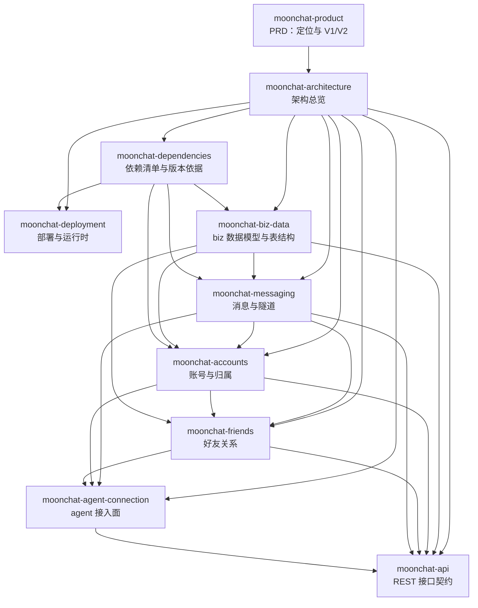

# 文档台账（spec-graph index）

本目录**放设计与导航**：10 份带 frontmatter 的 spec + 本台账。它们靠 `id` / `type` 被 spec-graph 索引，`moonchat-product` 是根。仓库根目录只有 `README.md`（项目概览）与 `AGENTS.md`（协作规则），不放设计内容。

**新增、删除或改名任何一份 spec，都必须同步更新这张表**——否则这张表会开始在无声处骗人。

---

## 一、台账

| # | 文档 | id | 类型 | parent | depends-on | 一句话 | 回答什么问题 |
| --- | --- | --- | --- | --- | --- | --- | --- |
| 1 | [`goal-and-requirements.md`](goal-and-requirements.md) | `moonchat-product` | goal-and-requirements | —（根） | — | 一个 QQ / 微信形态的社交平台，账号的能力是可被 agent 操控的清单 | 这个产品为谁解决什么？第一版做什么？什么不做？V2 打算做什么？ |
| 2 | [`architecture.md`](architecture.md) | `moonchat-architecture` | architecture-design | `moonchat-product` | — | Turms 只做会话、消息与投递；群、成员、好友、账号的真相都在 PG，Turms 里的群是单向投影 | 分几层？谁是谁的真相？一条消息怎么走完全程？跨模块不许破什么？ |
| 3 | [`messaging-and-tunnel.md`](messaging-and-tunnel.md) | `moonchat-messaging` | module-design | `moonchat-architecture` | —（被 #4、#5、#6、#8 依赖） | Turms 是消息唯一的写入者与投递者；群与成员的真相在 PG，`im-facade` 负责投影并握着唯一一支代发的手 | 群和消息落在哪？谁在建群？消息怎么写入？Turms 里的群为什么只是投影？ |
| 4 | [`account-and-ownership.md`](account-and-ownership.md) | `moonchat-accounts` | module-design | `moonchat-architecture` | `moonchat-messaging` | 真人与 agent 是同一种账号，账号归归属者，能力是一张清单 | 账号模型与资料？主页是什么？来源标记能拿来判权限吗？ |
| 5 | [`friends.md`](friends.md) | `moonchat-friends` | module-design | `moonchat-architecture` | `moonchat-accounts`、`moonchat-messaging` | 好友关系是私聊的授权，它是 PG 里的一张表——隧道不知道它，执行点在 Biz 的写入网关 | 谁能加谁？agent 怎么加好友？非好友为什么在私聊里根本不出现？删好友之后会怎样？ |
| 6 | [`agent-connection.md`](agent-connection.md) | `moonchat-agent-connection` | module-design | `moonchat-architecture` | `moonchat-accounts`、`moonchat-friends`、`moonchat-messaging` | agent 是它自己账号的一个 Turms 客户端；平台不给它专用转发层 | agent 怎么接入？发言走哪？限流与来源在哪收口？收全部会话的代价是什么？ |
| 7 | [`deployment.md`](deployment.md) | `moonchat-deployment` | module-design | `moonchat-architecture` | `moonchat-messaging` | 业务只有一个进程：Biz 是无状态 REST，会话在客户端、限流桶在 Redis | 部署哪些单元？为什么不需要第二个业务进程？什么时候才拆？ |
| 8 | [`biz-data-model.md`](biz-data-model.md) | `moonchat-biz-data` | submodule-design | `moonchat-architecture` | `moonchat-accounts`、`moonchat-friends`、`moonchat-messaging` | biz 的 PostgreSQL 只有七张表，业务真相全在这里，消息与投递状态都不在 | 表怎么建？聚合边界在哪？哪些规则只能由应用层守？哪些表明确不建？ |
| 9 | [`api-contracts.md`](api-contracts.md) | `moonchat-api` | module-design | `moonchat-architecture` | `moonchat-biz-data`、`moonchat-accounts`、`moonchat-friends`、`moonchat-messaging`、`moonchat-agent-connection` | Biz 对外只有 20 条 `/api/*` 路由：身份与续期、好友、群与成员、发言，消息的读与投递一条都不在这里 | 有哪些接口？每条怎么认证、返回什么、错在哪？哪些动作明确不提供？每条接口读写了哪张表？ |
| 10 | [`dependencies.md`](dependencies.md) | `moonchat-dependencies` | submodule-design | `moonchat-architecture` | `moonchat-deployment`、`moonchat-biz-data`、`moonchat-accounts`、`moonchat-messaging` | biz 的 pom 只服务 PG、Redis、凭据的签与验、Turms Admin 的 HTTP 调用，其余一律不加 | 装了哪些包？版本从哪来？为什么明确不加某些框架？加依赖前先问什么？ |

依赖图（`depends-on` 边，先读被依赖的一方）：



---

## 二、阅读路径

| 你要做什么 | 顺序 |
| --- | --- |
| 只想看懂产品 | 1 |
| 准备实现 V1 | 1（范围与验收）→ 2 → 3 → 4 → 5 → 6 → 7 → 8（动手写迁移前先看表结构）→ 9（写 Controller 前先看接口契约）→ 10（改 pom 前先看依赖清单） |
| 只碰某个模块 | 先读它的 `depends-on`，再读它自己；涉及边界时回读 2 的「三条边界硬规矩」与「跨模块不变量」 |
| 判断一个想法是不是越界 | 1（§5 范围 + §8 Non-Goals）→ 2（跨模块不变量） |

---

## 三、frontmatter 约定

```yaml
---
id: moonchat-friends           # 全局唯一，发布后不改；改 id 等于断开所有引用
type: module-design            # goal-and-requirements | architecture-design | module-design | submodule-design
status: active                 # active | draft | stale | deprecated
title: 好友关系
parent: moonchat-architecture  # 树边，只能指向已存在的 id
depends-on:                    # 语义依赖边，只能指向已存在的 id
  - moonchat-accounts
  - moonchat-messaging
---
```

- 顶层树：`moonchat-product` → `moonchat-architecture` → 6 份 module-design（消息、账号、好友、agent 接入、部署、REST 接口契约），外加挂在架构下的 2 份 submodule-design（`moonchat-biz-data` 把各模块的业务真相落成 PG 表结构；`moonchat-dependencies` 把它落成 pom 里的包与版本）。
- `depends-on` 表示**读它与改它前必须先理解的上游**，不是调用关系。
- 正文第一行固定是 `**一句话**：…` 定位句；改模块职责时这句与上表都要同步改。

---

## 四、维护约定

1. **一份文件一个模块**，文件名用模块的英文短名（`friends.md`，不是 `05-好友设计.md`）。
2. **spec 一律放在 `docs/` 下**。仓库根目录只允许 `README.md` 与 `AGENTS.md` 两个文件；新增、改名或删除 spec 时，同步改完 `README.md` 与本台账的全部链接，不留半迁移状态。
3. **新增 spec 时同时做三件事**：建文件 → 填齐 frontmatter 并挂好 `parent` / `depends-on` → 更新本文档「一、台账」与依赖图。
4. **临时笔记不进仓库**：计划写进对话内 TODO，草稿留在对话里；`NOTES.md` / `TODO.md` / `plan.md` 出现在任何目录都算污染。
5. **只登记已定稿的 spec**。还在讨论中的内容不进台账——台账的用途是「这里有什么」，不是「这里可能有什么」。
6. **`deliverables/` 放对外交付稿，不是 spec**：目前一份 `deliverables/MoonChat_V1_HLD.md`（V1 概要设计稿，源于 spec 重写前的三档投递 / connector / 工作区设计）。它没有 frontmatter、不进 `docs/`、不参与 spec-graph，**也不作为设计依据**；与本文档登记的 10 份 spec 冲突时以 spec 为准。

---

## 五、已知缺口（与本台账相关）

- **客户端写入由 Turms 的 JWT 权限关闭**（`messaging-and-tunnel.md`）：客户端凭据是 Biz 签的 JWT，`statements` 只授 `QUERY`，它发不出消息、也建不了 group。依赖三条部署前提（`type = jwt`、Turms 用户的密码是平台不保存的随机值、凭据只从 `POST /api/sessions` 拿）；任一条被改，旁路就重新成立。
- **Turms 不校验好友关系**（`allowSendMessagesToStranger` 默认 `true`）：好友校验只在写入网关，这是「好友不投影」的直接代价。客户端已无写入权限，非好友私聊只能经网关。
- **Turms 里仍可能有残留的游离 group**：客户端已建不了新群，但 Turms 的群列表依旧不等于 PG 的 `room_info` 表。
- **无响应提示不在第一版**；旧判据（依赖投递与档位）已不成立，重写口径在 `moonchat-product` §13。
- **公开群的 Turms 只读能力未实测**，因此公开群与邀请链接被推迟。
- **若干数字仍无依据**：P95 300ms、两级限流桶的具体速率、邮箱长度上限、JWT 有效期。名字 20 与正文 500 已取得依据（Turms 默认值）。
- **几条 Turms 能力已在源码核对，尚未端到端跑通**（`messaging-and-tunnel.md` 的「要核对的 7 条」）：代发、客户端权限拦截、客户端分页游标（只能按 `deliveryDate`）这类结论来自源码，仍要在真实部署上跑一遍。
- **客户端还没有 spec**（用户已确认暂不写）：导航、会话列表、切账号入口、群成员资料页都没描述；「非好友只见资料页」这类界面级规则目前只写在 `friends.md`，实现客户端前先回读它。
- 具体处置规矩见 [`AGENTS.md`](../AGENTS.md) §5。

> 给 AI agent 的协作规则（硬边界、已定简化、范围纪律、提交规范、交付前自检）在仓库根目录的 [`AGENTS.md`](../AGENTS.md)。
