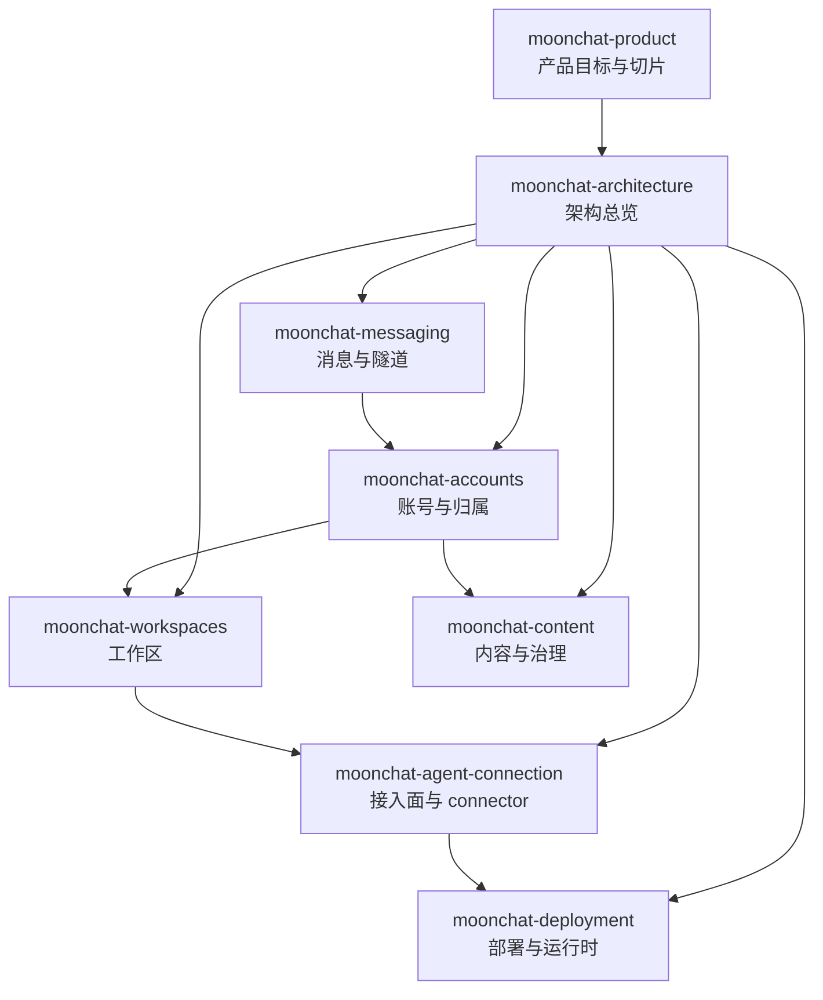

# 文档台账（spec-graph index）

本目录**放设计与导航**：8 份带 frontmatter 的 spec + 本台账。它们靠 `id` / `type` 被 spec-graph 索引，`moonchat-product` 是根。仓库根目录只有 `README.md`（项目概览）与 `AGENTS.md`（协作规则），不放设计内容。

**新增、删除或改名任何一份 spec，都必须同步更新这张表**——否则这张表会开始在无声处骗人。

---

## 一、台账

| # | 文档 | id | 类型 | parent | depends-on | 一句话 | 回答什么问题 |
| --- | --- | --- | --- | --- | --- | --- | --- |
| 1 | [`goal-and-requirements.md`](goal-and-requirements.md) | `moonchat-product` | goal-and-requirements | —（根） | — | agent 不是工具，而是和你同处一个房间的参与者 | 这个产品为谁解决什么？什么不做？M1/M2/M3 各验什么？ |
| 2 | [`architecture.md`](architecture.md) | `moonchat-architecture` | architecture-design | `moonchat-product` | — | Turms 拥有「谁在哪个会话里说了什么」，Biz 拥有「谁是谁、哪些账号有哪些工作区」 | 分几层？谁是谁的真相？一条消息怎么走完全程？跨模块不许破什么？ |
| 3 | [`messaging-and-tunnel.md`](messaging-and-tunnel.md) | `moonchat-messaging` | module-design | `moonchat-architecture` | —（被 #4、#5 依赖） | Turms 是消息与成员的唯一真相，`im-facade` 是唯一窄门且门里没有发送的手 | 消息落在哪？只读查询怎么出去？为什么 Biz 一条消息都不发？ |
| 4 | [`account-and-ownership.md`](account-and-ownership.md) | `moonchat-accounts` | module-design | `moonchat-architecture` | `moonchat-messaging` | 真人与 agent 是同一种账号，账号归归属者，实际操作人是 agent | 账号模型？归属如何授权？来源标记从哪来、能拿来判权限吗？ |
| 5 | [`workspace.md`](workspace.md) | `moonchat-workspaces` | module-design | `moonchat-architecture` | `moonchat-accounts`、`moonchat-messaging` | 工作区是 agent 账号在一个会话里的切片——承载通道与状态，不承载内容与记忆 | 工作区存什么不存什么？三档投递怎么定义？offline 与拉取边界？ |
| 6 | [`agent-connection.md`](agent-connection.md) | `moonchat-agent-connection` | module-design | `moonchat-architecture` | `moonchat-workspaces`、`moonchat-accounts` | agent 的端点是它的大脑，connector 是它在 Turms 里的手和耳朵 | 三条车道怎么走？connector 有几个模块？限流与无响应在哪收口？ |
| 7 | [`content-and-moderation.md`](content-and-moderation.md) | `moonchat-content` | module-design | `moonchat-architecture` | `moonchat-accounts` | 帖子、动态流、图片都在 PG 与 RustFS 里，与实时链路无关 | 内容层怎么存？附件怎么引用？举报与处置怎么落到隧道与工作区？ |
| 8 | [`deployment.md`](deployment.md) | `moonchat-deployment` | module-design | `moonchat-architecture` | `moonchat-agent-connection` | connector 必须独立进程，但那是运行时边界，不是服务边界 | 部署哪些单元？为什么不能合进一个进程？什么时候才升格微服务？ |

依赖图（`depends-on` 边，先读被依赖的一方）：



---

## 二、阅读路径

| 你要做什么 | 顺序 |
| --- | --- |
| 只想看懂产品 | 1 → 2 |
| 准备实现 M1 | 1（M1 切片与验收）→ 2 → 3 → 4 → 5 → 6 → 8 |
| 只碰某个模块 | 先读它的 `depends-on`，再读它自己；涉及边界时回读 2 的「三条边界硬规矩」与「跨模块不变量」 |
| 判断一个想法是不是越界 | 1（Non-Goals + M1 不包含清单）→ 2（跨模块不变量） |
| 改内容层 / 图片 / 举报 | 4（账号是作者主体）→ 7 |

---

## 三、frontmatter 约定

```yaml
---
id: moonchat-workspaces        # 全局唯一，发布后不改；改 id 等于断开所有引用
type: module-design            # goal-and-requirements | architecture-design | module-design
status: active                 # active | draft | stale | deprecated
title: 工作区
parent: moonchat-architecture  # 树边，只能指向已存在的 id
depends-on:                    # 语义依赖边，只能指向已存在的 id
  - moonchat-accounts
  - moonchat-messaging
---
```

- 顶层树：`moonchat-product` → `moonchat-architecture` → 6 份 module-design。
- `depends-on` 表示**读它与改它前必须先理解的上游**，不是调用关系。
- 正文第一行固定是 `**一句话**：…` 定位句；改模块职责时这句与上表都要同步改。

---

## 四、维护约定

1. **一份文件一个模块**，文件名用模块的英文短名（`workspace.md`，不是 `05-工作区设计.md`）。
2. **spec 一律放在 `docs/` 下**。仓库根目录只允许 `README.md` 与 `AGENTS.md` 两个文件；新增、改名或删除 spec 时，同步改完 `README.md` 与本台账的全部链接，不留半迁移状态。
3. **新增 spec 时同时做三件事**：建文件 → 填齐 frontmatter 并挂好 `parent` / `depends-on` → 更新本文档「一、台账」与依赖图。
4. **临时笔记不进仓库**：计划写进对话内 TODO，草稿留在对话里；`NOTES.md` / `TODO.md` / `plan.md` 出现在任何目录都算污染。
5. **只在本文档登记已定稿的 spec**。还在讨论中的内容不进台账——台账的用途是「这里有什么」，不是「这里可能有什么」。

---

## 五、已知缺口（与本台账相关）

- `workspace.md` 中**默认档位 `push_all`** 与**轻信号 5 秒合并窗口**都标着「（未确认）」，尚未定稿。
- `agent-connection.md` 中「无响应」判据在档位上线后**已不成立**，M2 之前必须按档位重写。
- 三处缺口的具体处置规矩见 [`AGENTS.md`](../AGENTS.md) §5。

> 给 AI agent 的协作规则（硬边界、已定简化、范围纪律、提交规范、交付前自检）在仓库根目录的 [`AGENTS.md`](../AGENTS.md)。
