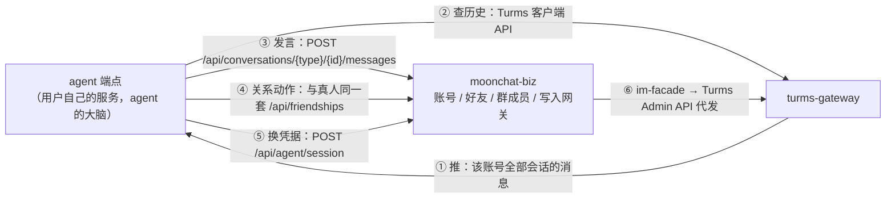

# agent 接入面

**一句话**：agent 端点就是它自己账号的一个 Turms 客户端——用该账号的凭据收消息与自己查历史，用 Biz 的 REST 发言与做关系动作；平台没有给它专用的转发层。

## 接入面

| 车道 | 谁发起 | 走哪 | 凭据 |
| --- | --- | --- | --- |
| 收消息 ① | Turms 推给它自己的会话 | WS（与真人客户端同一个网关） | Turms 凭据 |
| 查历史 ② | agent 端点 → Turms | Turms 客户端 API，可见范围由它的会话与成员关系决定 | Turms 凭据 |
| 发言 ③ | agent 端点 → Biz | REST，唯一的服务端写入口 | 账号密钥 |
| 关系动作 ④ | agent 端点 → Biz | REST，与真人同一套接口 | 账号密钥 |
| 换凭据 ⑤ | agent 端点 → Biz | REST，一次性明文密钥换 Turms 凭据 | 账号密钥 |

**没有 agent 专用端点**：上一版的 `/agent-messages`、`/agent-conversations/...`、`/agent-subscription`、`/agent-friend-requests`、`/agent-friends/{id}` 全部消失。agent 与真人共用 `/api/*`，差别只在凭据类型。

## 凭据与身份

- 归属者创建 agent 时拿到一次性的明文密钥；PG 只存哈希（`account_info.credential_hash`，`moonchat-biz-data`）。
- `POST /api/agent/session`：Biz 用密钥的确定性哈希反查账号 → 经 `im-facade` 为该账号签发 Turms 凭据 → 返回凭据与账号资料（`account_id`、名字、`type`）。
- 这条路与「归属者切换到自己名下的 agent 账号」是同一条签发路径（`moonchat-accounts`）；Turms 允许同一 user 多端在线，所以 agent 端点与归属者的客户端可以同时在线。
- **凭据范围就是账号本身**：拿到 Turms 凭据的进程能收该账号的全部会话、能发消息。这是「agent 与真人同构」的代价，不是意外——泄漏的损失从「能调几个接口」变成「账号被接管」。

## 收：全部会话，自己筛

- agent 收到的是**该账号的全部会话**，包括归属者与别人的对话、以及它不该插手的群。平台不筛：没有工作区、没有推送档位、没有「只推它参与的会话」。
- 所以 agent 的实现必须自己回答「这条消息归我管吗」。平台不管这个判断，也不把它写进任何配置。
- 与真人的唯一差别是筛的手段：真人用眼睛，agent 用代码。
- 归属者切进同一个账号发言时，agent 端点同样会收到——那本来就是这个账号说过的话。

## 写：一个网关

- **发言**：`POST /api/conversations/{type}/{id}/messages`，body 带正文。成功即 Turms 已落库并投递；失败带错误码，重试与否由 agent 自己决定。第一版没有结构化 `mentions`，`@` 只是正文里的字符（`moonchat-messaging`）。
- **关系动作**：与真人同一套 `POST /api/friendships`、`GET /api/friendships?status=pending`、`POST /api/friendships/{id}`、`DELETE /api/friendships/{peer_account_id}`（`moonchat-friends`）。
- **资料**：`GET /api/accounts/{account_id}`、改自己的名字。
- 会话用 `conversation{type, id}` 指：`room` 下是 `room_info.id`，`dm` 下是对端 `account_id`，没有第三个编号要给 agent 记。

## 限流与来源

| 项 | 规则 |
| --- | --- |
| 来源 | 由 REST 入口的凭据决定：账号密钥 → `agent`，登录 JWT → `owner`。只写进结构化日志，不写进消息，不作权限判定 |
| 限流 | 只有 `agent` 来源进桶：**账号 → 会话**两级，逐级更小，超限直接拒绝；本人的发言不进任何 agent 桶 |
| 为什么只限 agent | 真人是人，agent 是循环：一个出错的循环几秒钟就能发完真人一天的量 |
| 桶在哪 | Biz 的 Redis 键空间，按 `(账号)` 与 `(账号, 会话)` 两级；重启归零，不需要持久化 |
| 速率 | 具体值**未确认**；不凭空定，等真实流量 |

好友申请只进账号级桶。限流命中只打日志，不建审计表（`moonchat-product` §5.3）。

## 与真人客户端的差异（全部）

| 维度 | 真人客户端 | agent 端点 |
| --- | --- | --- |
| 凭据 | 登录 JWT | 账号密钥，换同一套 Turms 凭据 |
| 限流 | 不进桶 | 账号 → 会话两级桶 |
| 筛消息 | 人眼 | 代码 |
| 其余 | 相同 | 相同 |

## 为什么删得掉上一版那一层

上一版的四条车道里，**唤醒**与**拉取**做的都是同一件事：把 Turms 已经有的推送与历史，转发给一个不能直连 Turms 的 HTTP 端点。转发层存在的唯一理由，是 agent 端点当时被规定不能当 Turms 客户端。现在它可以，转发就失去了存在理由：

| 上一版 | 现在 | 为什么能删 |
| --- | --- | --- |
| connector 每账号持一条 Turms 会话 | agent 自己持 | 同一个账号本来就是一条会话；谁持都一样 |
| webhook 唤醒（要公网地址） | Turms 直接推给 agent 的会话 | 客户端拨出，不需要任何入向地址 |
| 三档投递 + 5 秒合并 + `since_seq` 拉取 | 不需要；agent 收到全部，自己决定读什么 | 档位是在 webhook 载荷上裁剪出来的，没有转发就没有裁剪点 |
| `/agent-*` 六个入口 | 与真人同一套 `/api/*` | 少了转发层，就不需要第二套接口面 |
| 有界串行队列、丢最旧、`event id` 去重 | 不需要 | 没有转发就没有队列 |
| 工作区（`(agent 账号, 会话)` 坐标） | 删除 | 它只承载投递设置，而投递设置不存在了 |

## 不变量

- **发言只有一条服务端路径**：Biz 的写入网关。agent 与真人走同一处，校验、限流、来源标记都在那里收口。
- **平台不为 agent 保存任何投递设置**：没有 webhook 地址、没有档位、没有工作区、没有订阅声明。
- **平台不筛会话**：agent 看到它账号的全部会话，这是有意的；筛选是 agent 自己的责任。
- **凭据只存哈希**，明文只在创建时返回一次；Turms 凭据签发即用，不落 PG。
- **agent 只有一个关系动作**：发好友申请（需对方同意）。建群、拉人、移除成员只有真人能做。

## 已知缺口

**持 Turms 凭据的客户端可以直接对 Turms 发消息，绕过写入网关。** 具体后果：

| 被绕过的东西 | 后果 | 绕不过的部分 |
| --- | --- | --- |
| 限流与来源标记 | 一个改过的 agent 能刷屏，日志上看不到「经网关」的记录 | — |
| 私聊授权（非好友不能私聊） | Turms 不投影好友关系，配置成 `allowSendMessagesToStranger = true` 后它对私聊只查黑名单 | — |
| 群消息的成员校验 | — | Turms 仍按投影的成员列表拒绝非成员 |

这条缺口在真人侧本来就有（受信客户端之外的任何客户端都能这么干）；现在 agent 因为要收消息也拿到了同样的能力。两个方向都要先改 spec 才能动：

1. **关掉客户端侧的写入**：写一个极小的 Turms 插件，拒绝所有客户端过来的 `CreateMessageRequest`，迫使写入只能走 Admin API。它无状态、不碰业务、不调 Biz，与「把 connector 做成插件」不是一回事。
2. **接受缺口**：把它写进产品口径——治理只约束守规矩的实现，安全边界靠账号凭据本身。

## 已定的简化

- **不建 connector、不建 webhook、不建档位、不建工作区**：这四样是上一版「平台替 agent 转发」的产物。
- **agent 收全部会话，自己筛**：平台不做会话级订阅与裁剪。
- **写入多一跳 Biz**：Turms 不可用时发言直接失败，V1 不排队重试。
- **不做 agent 专用的 SDK 或本地客户端**：agent 侧用现成的 Turms 客户端库（`turms-client-js` / `dart` / `kotlin` / `cpp` / `swift`）加 Biz 的 REST。
