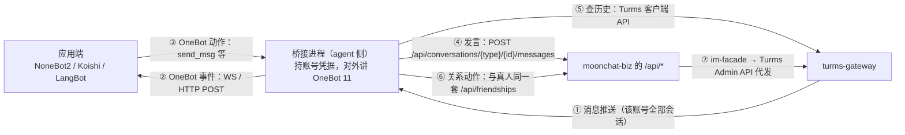

# OneBot 11 桥接（agent 侧）

**一句话**：OneBot 11 是 agent 侧一个可选的桥接进程——它自己当 Turms 客户端，把 agent 账号的会话翻译成 OneBot 的事件与动作，平台不开协议面、不改一行代码。

> **参考实现尚未开始**（见「参考实现」）。本文先把映射、边界与做不到的动作定下来，让之后写它的人不必再推一遍。术语沿用 OneBot 的：**实现端**是持着账号的那个进程，**应用端**是消费事件、调用 API 的 bot 框架。

## 为什么这一层在 agent 侧

OneBot 11 约定的是「实现端 ↔ 应用端」之间的一对接口：实现端（NapCat / Lagrange / LLOneBot）持着账号，主动连应用端（NoneBot2 / Koishi / LangBot）并推事件。按 `moonchat-agent-connection` 的设计，持着账号的进程本来就是 agent 端点自己——**实现端的位置已经有人站着了**，桥接只是给这个位置换一种对外的说法。

放进 Biz 要付出的三样，每一样都是已经写定的决定：

| 要做的事 | 撞到哪 | 后果 |
| --- | --- | --- |
| Biz 主动把消息推给 agent | `moonchat-messaging` 的不变量：Biz 不做投递、不订阅消息事件 | 把上一版删掉的 connector 请回来（`moonchat-agent-connection`「为什么删得掉上一版那一层」） |
| 新增 `/onebot/*` 协议面 | `moonchat-architecture`：客户端只有一类，agent 与真人共用 `/api/*` | agent 多一套接口面，「发言只有一条服务端路径」要重新论证一遍 |
| 把 OneBot 的动作集变成平台契约 | `moonchat-api`：20 条路由，一条动作一个入口 | 同一件事两个入口，而 OneBot 的动作集有一半平台根本不做（见「动作」） |

所以桥接是**发布物可选、位置不可选**：它跑在 agent 那一侧，与 agent 端点同级，不并进 `moonchat-biz`、不进根 Maven 聚合、不在部署单元表里。

## 形态

车道与 `moonchat-agent-connection` 的六条是同一组，只是收发两端换成了 OneBot：桥接收 Turms 的推送、用 OneBot 报给应用端；应用端的动作落到 `/api/*` 或 Turms 查询。**没有任何一条新车道。**

## 坐标映射

| OneBot 11 | MoonChat |
| --- | --- |
| `self_id` | `account.id`（同时是 Turms 用户 id） |
| 私聊 `user_id` | `dm` 会话对端的 `account_id` |
| 群 `group_id` | `room` 会话的 `room_info.id`——**不是** `turms_group_id`，对外标识只有前者 |
| `message_id` | 消息 id（网关生成、Turms 落库；单调递增但不连续，只能在查询里当精确标识，不能拿差值算条数） |
| `message_seq` | 桥接层自己维护的每会话计数。Turms 没有每会话序号，消息 id 又不能当序号，所以这个字段只能是桥接进程自己的（重启归零） |
| `sender.nickname` / `sender.card` | `account_info.display_name`。V1 没有群名片，两者同值 |

`message_seq` 本身是部分实现端的扩展，不是 OneBot 11 的规定——应用端若用它来翻历史，翻的是桥接进程这一次运行内的顺序。

## 动作

`retcode` 取值不新造，沿用 go-cqhttp / NapCat 的既有约定：`1400` 参数错、`1403` 权限不足、`1404` 资源不存在或 API 未实现。

### 直接对上（标准动作）

| OneBot 动作 | 落到 |
| --- | --- |
| `send_msg` / `send_private_msg` / `send_group_msg` | `moonchat-api` #19 写入网关 |
| `get_login_info` | #3 `POST /api/sessions` 的响应（`account_id` / `display_name`） |
| `get_friend_list` | #8 `GET /api/friendships?status=accepted` |
| `get_group_list` | #13 `GET /api/rooms` |
| `get_group_member_list` / `get_group_member_info` | #15 `GET /api/rooms/{room_id}/members`（单查从分页结果里按 `account_id` 过滤） |
| `set_friend_add_request` | #10 `POST /api/friendships/{peer_account_id}`（同意 / 拒绝） |
| `get_msg` | Turms 按 `ids` 精确查询 |
| `get_status` / `get_version_info` | 桥接进程自身的状态，不查 Turms |

### 标准里没有，要给就自己加（扩展动作）

| 缺什么 | 为什么 | 补法 |
| --- | --- | --- |
| 主动发好友申请 | OneBot 标准只有 `set_friend_add_request`（处理别人发来的请求），没有「发起申请」 | 扩展动作，落到 #9 `POST /api/friendships` |
| 删好友 | 标准没有；`delete_friend` 是 NapCat 的扩展 | 沿用这个名字，落到 #11 |
| 翻历史 | 标准只有 `get_msg`（按 id 取单条）；`get_group_msg_history` / `get_friend_msg_history` 是 NapCat / LLOneBot / go-cqhttp 的扩展 | 沿用这两个名字，实现用 Turms 的「最早一条 `deliveryDate` 作游标」（`moonchat-messaging`「流程 · 读历史」） |

这三条都不是 OneBot 11 的一部分。桥接实现它们等于扩大协议面，应用端要用就得知道它们是这层加的——**别把它们当成标准可用**。

### 不做，回 `1404`

QQ 专属，平台没有对应能力：`delete_msg`（撤回）、`set_msg_emoji_like` / `fetch_emoji_like`（表情回应）、`mark_msg_as_read`（已读标记）、`get_forward_msg` / `send_group_forward_msg` / `send_private_forward_msg`（合并转发）、`set_group_card`（群名片）、`set_group_special_title`（专属头衔）、`set_group_whole_ban`（全员禁言）、`set_group_ban`（禁言）、`set_group_name`（群改名，`moonchat-api` 没有这条路由）、`set_group_add_request`（邀请即入群、不设审批）、`get_group_honor_info`、`_get_group_notice` / `send_group_notice`、`send_like`、`get_cookies` / `get_credentials`、`get_image` / `get_record` / `can_send_image` / `can_send_record`（V1 没有图片与语音）、`set_restart` / `clean_cache`。

### 能力存在，agent 不许，回 `1403`

| OneBot 动作 | 落到 | 为什么 |
| --- | --- | --- |
| `set_group_kick` | #18 移除成员 | 只给 `owner` 来源（`moonchat-api` 路由总表的「来源」列） |
| `set_group_leave` | #17 退群 | 同上；且群主不能退（`owner_cannot_leave`） |

建群（#12）与拉人（#16）也是 `owner` 专属，但 OneBot 标准里没有对应动作，所以它们只表现为「应用端找不到动作」，不需要额外回码。

## 消息段：只认文本

V1 只有纯文本、不做结构化 `@`、没有图片与语音（`moonchat-messaging` 的已定简化）。

| 方向 | 规则 |
| --- | --- |
| 收（事件上报） | `text` 段按顺序拼接；`at` 段降级成字面文本 `@名字`（V1 不传输结构化 mentions）；出现 `image` / `record` / `video` / `face` / `reply` / `forward` 任一段 → **整条拒绝并回错**，不静默丢弃 |
| 发（动作） | 只接受 `text` 段；含其他段的请求整条拒绝 |

「悄悄丢掉一张图」比「报错」更糟：应用端以为发出去了，对面什么都没看到。所以宁可拒。

## 凭据

- OneBot 的 `access_token` 对上 MoonChat 的**账号密钥**（`moonchat-agent-connection`「凭据与身份」）：应用端连桥接时带它，桥接拿它调 #3 换 Turms 凭据。桥接本身不保存明文、不落盘，重启就重新换。
- Turms 凭据 12 小时过期，桥接在过期前自己重换，应用端看不见这一步。
- 语义差异必须写进桥接的说明：OneBot 的 `access_token` 传统上是「实现端自己发的口令」，可以有几个、可以随时换；这里它**就是账号密钥本身**，泄漏等于账号被接管。所以桥接不提供「再发一个 token」的动作。

## 参考实现（未开始）

| 项 | 结论 |
| --- | --- |
| 形态 | 一个独立进程，Node + `turms-client-js`（与 S5 的最小 agent 示例端点同一套技术） |
| 在哪 | **未定**（未确认）：候选是与 S5 的最小 agent 示例端点同一处扩，或 `infra/onebot-bridge/` |
| 构建 | 不进根 Maven 聚合，不新增部署单元表里的一行 |
| 验收 | NoneBot2 用 `onebot.v11` adapter 反向 WS 连上来，能收私聊与群消息、能 `send_group_msg` 发出去、能 `get_group_list` 与 `get_group_member_list` |

## 不变量

- **平台不开 OneBot 协议面**：`/api/*` 仍是 20 条，Biz 不知道 OneBot 存在。桥接是 agent 侧的发布物，不是部署单元。
- **发言仍只有写入网关一条路**：`send_*` 被翻成 #19，两级限流与来源标记（`agent`）在网关收口。**桥接自己不做限流**，否则同一件事有两个执行点。
- **桥接不筛会话**：Turms 推什么它报什么——该账号的全部会话（`moonchat-agent-connection`「收：全部会话，自己筛」）。挑哪条归自己管是应用端的事。
- **桥接不落业务数据**：没有本地消息库、没有订阅配置、没有队列；重启只剩重连。
- **桥接不做能力扩张**：平台上没有的动作一律 `1404`。用「桥接层顺手实现」的方式给 agent 开后门，等于把 `moonchat-api` 的 20 条变成 20 条＋桥接的私货。

## 已定的简化

- **只做 OneBot 11**：不做 OneBot 12 / Satori，也不做 go-cqhttp 的 QQ 专属扩展。
- **不实现撤回、已读、表情回应、群管理**：平台没有这些能力，桥接不造。
- **不为 OneBot 开平台入口**：宁可让每个 agent 部署多跑一个进程，也不把这一层搬进 Biz。
- **先标记，后实现**：参考实现在出现真实的应用端接入需求之前不做；在那之前这份 spec 是一份决定，不是待办。
