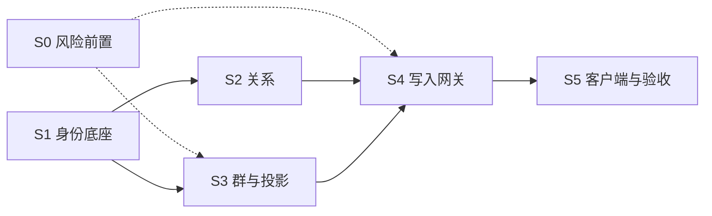

# V1 施工切片

**一句话**：V1 按纵切切成 S0–S5 六段，每一段结束时都留下一个跑得起来、验得完的状态，而不是按层铺一半。

## 0. 这份文档管什么

| 本文管 | 本文不管 |
| --- | --- |
| 施工顺序、每片的交付边界、片末必须成立的判据、跨片约定 | 行为与契约本身（在另外 10 份 spec 里）、V2 的计划（`moonchat-product` §13） |

**它不是新的需求来源**：任何一片都不许引入 spec 里没有的接口、表或行为。片内发现 spec 没定的东西，先补 spec 再写代码（`AGENTS.md` §2）。

## 1. 为什么纵切

| 切法 | 形状 | 结论 |
| --- | --- | --- |
| 横切（先铺 20 条路由骨架，再逐条填逻辑） | 接口面一次铺齐，判据全压在最后 | 不选：中间态是一批能调通但不校验的接口，「每片可验证」不成立；校验顺序被摊薄，而写入网关要求严格串行（`moonchat-api` §7） |
| 纵切（每片一个端到端闭环） | 片内自带迁移、DTO、校验、外部调用、测试 | 选它：片末能用一条命令或一次操作验完，返工范围被限制在片内 |

判据的总落点是 `moonchat-product` §6 的六条验收判据。它们不是分片的依据（六条都在 S5 之后才全部成立），而是每一片都要往它们身上加一块。

## 2. 切片总表

| 片 | 交付 | 涉及的表 | 覆盖接口 | 片末判据 | 验证工具 |
| --- | --- | --- | --- | --- | --- |
| **S0 风险前置** | 扩 `infra/turms/smoke`，把只剩源码结论的四条 Turms 运行时确认跑掉 | — | — | Admin 建 group 成功且能回填 group id；成员集合能按 PG 对齐；被移出群的账号再被代发时被拒；代发消息到达在线端 | node 脚本 |
| **S1 身份底座** | 三个迁移文件建齐 7 张表；建 Turms 用户；签 Turms JWT；登录 JWT 与续期 | `account`、`account_info` | #1 #2 #3 #4 #20 | 注册 → 登录 → `/api/sessions` → `turms-client-js` 用这份凭据登录 `/im` 成功；Turms 用户 id == `account.id`；QUERY-only 发消息仍被拒 1106；续期后仍是同一账号 | Testcontainers 接口测试 + smoke |
| **S2 关系** | agent 账号与密钥、改名、资料页、好友四条、账号级限流桶 | `friendship`、`friendship_reverse` | #5 #6 #7 #8 #9 #10 #11 | 申请 → 同意 → 双方列表出现；删好友后 404、再申请复用原行；agent 用密钥换到凭据；agent 建不了 agent（403） | Testcontainers 接口测试 |
| **S3 群与投影** | 群七条；`im-facade` 建群与 full reconcile；最小重放器 | `room_info`、`room_member`、`account_room` | #12–#18 | 建群后 `turms_group_id` 回填；Turms 成员集合与 `room_member` 有效行一致；投影失败不回滚业务写，且 `pending` 被重放收敛 | Testcontainers 接口测试 + smoke 断言 |
| **S4 写入网关** | 发言、两级限流桶、来源日志、503 映射 | 只读 | #19 | 非好友私聊 403；非成员群消息 403；被移出群后立即被拒；agent 超限 429 且同账号真人不受影响；PG 零写入 | Testcontainers 接口测试 + smoke |
| **S5 客户端与验收** | Flutter Web 最小面；最小 agent 示例端点 | — | — | `moonchat-product` §6 的六条逐条走通 | 手工走查 + 示例端点 |

接口编号取 `moonchat-api` §2 的接口总表。

## 3. 顺序与自由度

`S1` 是所有片的硬前置：没有账号与凭据，后面每一片都验不了。`S2` 与 `S3` 互不依赖——拉人进群不要求好友，好友也不涉及群，可以并行或对调。`S4` 同时依赖 `S2`（好友授权）与 `S3`（成员授权），不能提前。`S5` 依赖 S1–S4 的全部接口面。

虚线是「先知道答案，才能按现设计写」，不是调用关系。

## 4. 逐片边界

### S0 风险前置

- **做什么**：把 `moonchat-messaging`「要核对的 7 条」里只剩源码结论、还没在真实部署上跑过的四条跑掉——Admin 建 group、成员集合对齐、移出群后带 `senderId` 代发被拒、代发消息到达在线端。
- **不做什么**：不写业务代码，不在 Biz 里留任何「临时验证接口」。
- **结束条件**：结论回写 `moonchat-messaging` 的缺口表与冒烟结果表。某条不可行时，先改 spec，再进 S1。
- **为什么在最前**：它决定 S3 的投影与 S4 的授权链能不能按现设计写。放到后面意味着返工，而不是调整。

### S1 身份底座

- **做什么**：迁移（7 张表一次建齐，见 §5）；`im-facade` 的建用户（指定 id、随机密码 ≤ 16 字符，`moonchat-messaging`「凭据与客户端权限」）与 Turms JWT 签发；#1 注册、#2 登录、#3 换 Turms 凭据、#4 我的账号、#20 续期。
- **边界**：#3 只做归属者形态（带登录 JWT）。账号密钥形态放到 S2，因为密钥是 #5 的产物。#4 在这一片只会返回「我自己」，agent 那半边随 S2 补齐。
- **结束条件**：见总表；另外注册成功时 `turms_sync_state = 'synced'`，建 Turms 用户失败要连同账号行一起回滚——不留孤儿账号（`moonchat-product` §10 第 12 条）。

### S2 关系

- **做什么**：#5 建 agent 账号（`credential_hash` 用确定性 HMAC-SHA256 + pepper，明文密钥只在这个响应里出现）、#6 改名并同步 Turms、#7 资料页、#8–#11 好友四条；一个账号级限流桶，只给 `agent` 来源的好友申请用。
- **边界**：不碰群，好友也不投影进 Turms（`moonchat-messaging`）——所以这一片没有任何**群 / 成员 / 会话**的 Admin 调用；Admin 只在建 agent 账号（建用户）与改名（`PUT /users`）两处出现，均与注册同口径（没确认就整笔回滚）。
- **结束条件**：三条只能由应用层守的规则都能被测试断言到——规范序（小 id 在前）、双表单事务同写、拒绝写 tombstone 而不是新增枚举值。

### S3 群与投影

- **做什么**：#12–#18；`im-facade` 的 createGroup 与 full reconcile；最小重放器。
- **重放器最小版**：扫 `turms_sync_state = 'pending'` 的记录，按 PG 重算一次投影。不做退避曲线、不做告警、不做分布式互斥——V1 单实例起步（`moonchat-deployment`）。扫描间隔写进配置并标（未确认）。
- **边界**：投影失败不回滚 PG 的业务写；`turms_group_id` 由 Turms 生成后回填，不由 Biz 指定（`moonchat-messaging`「要核对的 7 条」第 2 条）。
- **结束条件**：拉人、退群、移除之后，Turms 的成员集合与 `room_member` 的有效行逐条一致。

### S4 写入网关

- **做什么**：#19，严格按 `moonchat-api` §7 的顺序建链：认证凭据 → 归属 → 会话解析 → 授权事实 → 限流 → 来源标记写日志 → 交给 `im-facade` 代发。
- **边界**：PG 零写入；消息标识只用 Turms 消息 id；发送者只取自凭据，不接受请求体自报；`503` 只表示没拿到 Turms 的确认，不做幂等（`moonchat-api` §7 的已写行为）。
- **结束条件**：两条授权拒绝（`not_friend` / `not_room_member`）、被移出群后的立即拒绝、`429` 不影响同账号真人、`503` 映射，各有一条测试。

### S5 客户端与验收

- **做什么**：Flutter Web 最小面——注册登录、切账号、好友与申请、私聊、群、资料页、用 Turms 会话收消息并按最早一条的 `deliveryDate` 往前翻（`moonchat-messaging`「职责」里的消息标识一条）；一个跑在归属者机器上的最小 agent 示例端点：换凭据、连 `/im`、回一句话。
- **边界**：客户端没有 spec（`AGENTS.md` §5 缺口 8）。界面规则只能从 `moonchat-friends`（私聊入口只有好友列表与资料页）与 `moonchat-accounts`（主页字段）里读；需要新规则时先补 spec。V1 明确不提供的入口（搜人、临时会话、群邀请链接、发帖）不因为「顺手」而出现。
- **结束条件**：`moonchat-product` §6 六条逐条成立，任一条不成立就不算完成。

## 5. 跨片约定

| 约定 | 内容 | 理由 |
| --- | --- | --- |
| 迁移文件 | 按聚合切三个：account（`account`、`account_info`）、friendship（`friendship`、`friendship_reverse`）、room（`room_info`、`room_member`、`account_room`） | 七张表的 DDL 已定稿（`moonchat-biz-data` §4），一次建齐不产生无效的中间结构；按聚合切让每片的 diff 落在自己的文件里 |
| agent 示例端点 | 挂在 `infra/turms/smoke` 里扩，不新建目录 | 它和冒烟是同一件事（都用 `turms-client-js` 走真实 Turms），另建目录要多一套构建 |
| 验证 | 每片配 Testcontainers 接口测试（PG 与 Redis 已在容器里跑通）；Turms 侧一律靠 smoke 脚本断言 | 片末判据必须可重跑，手验只作补充 |
| 重放器 | 只在 S3 出现一次，最小版 | 见 S3 |
| spec 回写 | S0 → `moonchat-messaging` 的缺口表与冒烟结果；S3 → 投影重放的口径；S5 → 客户端界面规则（与现有 spec 不符时先改 spec） | `AGENTS.md` §2「改行为 = 改 spec」 |

## 6. 片内不许做的事

- 不许为「先跑起来」加 dev-only 的配置开关、mock 服务或内存版仓储——V1 的依赖在容器里都起得来。
- 不许把片内一次性的逻辑提前抽成跨片共用的 helper 或框架（`AGENTS.md` 的施工逻辑第 3 条）。
- 不许因为某一片「顺便」而新增路由、表、列；缺什么先改 spec。
- 不许在片与片之间留下 commit 级的半迁移状态：spec 与代码在同一次提交里一致（`AGENTS.md` §8）。

## 7. 顺序可换，判据不可降

片的顺序可以按实际风险调整（例如把 S3 提到 S2 之前），但每一片的片末判据不能删、不能标「以后补」。某片判据不成立时不进下一片——否则后面每一片都建立在一个错误的前提上。
